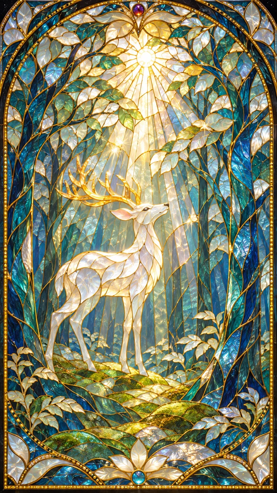

# Stained-Glass Window: White Deer in the Forest (9:16)

**中文标题：** 彩色玻璃镶嵌窗：林间白鹿（9:16）  
**ID:** `gi25-x-1537` · **Mode:** `generate`  
**Categories:** `general`  
**Tags:** `x-twitter`, `community`, `gpt-image-2.5`, `x-direct`, `zh`



### Stained-Glass Window: White Deer in the Forest (9:16)

```text
Create an image with the following visual system. Replace the subject as specified.

Visual system (light, color, composition, medium, mood):
【画面风格】一幅竖幅约 9:16 的彩色玻璃镶嵌窗画。画面由几百块形状各异的玻璃片拼成，每块之间是细而有金属光泽的黄铜或金色铅条，铅条线流畅、闭合、不断线。玻璃是珠光和乳白的半透明质感：奶白、珍珠灰、青蓝、深海蓝为主，局部带琥珀金和一两颗彩色圆珠玻璃；光从画面后方透过来，亮部玻璃发暖白的光，暗部沉在深青蓝里，玻璃内部有云母一样的丝状纹理。画面中心偏上有一处最亮的发光点，光束像放射状的长玻璃条向外展开，几处有极小的星芒高光。局部用金色点状纹的细带做装饰边。不要照片、不要油画笔触、不要 3D 塑料感，不要文字和签名。浓郁、闪耀，晚上看像一扇亮着的高窗。

New subject:
【主体】林间的一只白鹿，站在树干之间，树干是青蓝玻璃条，一束暖白的光从上方穿过树冠打在鹿身上，地面是铺着碎玻璃的苔地。鹿是乳白色，角带一点琥珀金。
```

- **Recommended model:** `gpt-image-2.5-sunburst`
- **Settings:** _(defaults)_
- **Source:** [community](https://x.com/static_stare/status/2121954245792629247) — @static_stare
- **License note:** Original public X post; quoted with attribution — remix with attribution
- **Notes:** Collected directly from X; original post https://x.com/static_stare/status/2121954245792629247; post text names GPT Image 2.5; discovered via X search, prompt re-verified against the original X post via api.fxtwitter.com; verified=True; visual-system + replaceable-subject template; prompt for image 1 of 4 (the author offers the other three on request); post names GPT Image 2.5 without a Flare/Sunburst variant; preview is image 1
- **Preview:** `previews/gi25-x-1537.webp`
