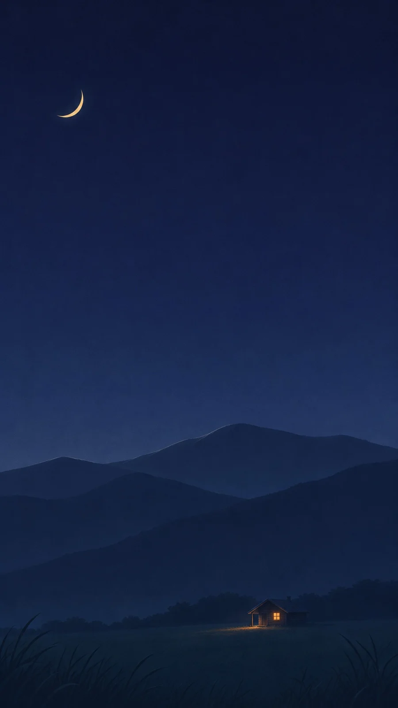

# Quiet Moonlit Night: One Warm Cabin Light Under Blue Hills (9:16)

**中文标题：** 月下夜景：蓝色山影下一盏暖灯小木屋（9:16）  
**ID:** `gi25-x-1538` · **Mode:** `generate`  
**Categories:** `general`  
**Tags:** `x-twitter`, `community`, `gpt-image-2.5`, `x-direct`, `zh`



### Quiet Moonlit Night: One Warm Cabin Light Under Blue Hills (9:16)

```text
Create an image with the following visual system. Replace the subject as specified.

Visual system (light, color, composition, medium, mood):
【画面风格】一张竖幅约 9:16 的安静夜间远景插画。上方约三分之二是深蓝到靛蓝的夜空，颜色从上往下略微变浅，带极细的颗粒，几乎没有星；一弯细细的暖黄月牙挂在左上，是画面里最亮的冷暖对比点。中景是几座层层叠叠的深蓝山影，比天空更深一个色阶，轮廓柔软像剪影，边缘只有一圈极淡的月光。主体很小，只占画面底部不到十分之一，用一点暖橙黄的灯光点亮，是整张画里唯一的暖色，灯光在地面或水面上洒出一小片光。前景是几丛深色的草叶。光线很弱，对比靠暖冷和明暗，不要大面积发光、不要雨、不要雾灯。像睡前翻到的一张手机壁纸。不要人物特写、不要现成的动画角色、不要文字和印章、不要火车。

New subject:
【主体】山脚下一间小木屋，只有一扇窗亮着暖橙黄的灯，门口地面被照出一小块亮。屋后是一排深蓝的山影，月牙在左上。
```

- **Recommended model:** `gpt-image-2.5-sunburst`
- **Settings:** _(defaults)_
- **Source:** [community](https://x.com/static_stare/status/2121968304516628564) — @static_stare
- **License note:** Original public X post; quoted with attribution — remix with attribution
- **Notes:** Collected directly from X; original post https://x.com/static_stare/status/2121968304516628564; post text names GPT Image 2.5; discovered via X search, prompt re-verified against the original X post via api.fxtwitter.com; verified=True; visual-system + replaceable-subject template; prompt for image 1 of 4 (the author offers the other three on request); post names GPT Image 2.5 without a Flare/Sunburst variant; preview is image 1
- **Preview:** `previews/gi25-x-1538.webp`
