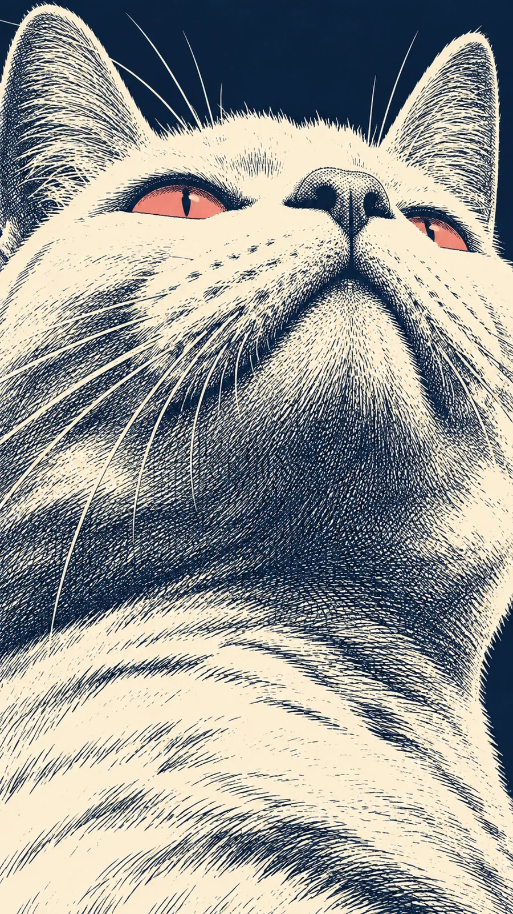

# Three-Color Screen Print, Low-Angle Close-Up: White Cat (9:16)

**中文标题：** 三色丝网仰角特写：白猫（9:16）  
**ID:** `gi25-x-1539` · **Mode:** `generate`  
**Categories:** `general`, `poster-typography`  
**Tags:** `x-twitter`, `community`, `gpt-image-2.5`, `x-direct`, `zh`



### Three-Color Screen Print, Low-Angle Close-Up: White Cat (9:16)

```text
Create an image with the following visual system. Replace the subject as specified.

Visual system (light, color, composition, medium, mood):
【画面风格】一张竖幅约 9:16 的限色丝网印刷海报特写：机位极低、几乎从下往上仰拍，主体被推到离镜头非常近，占满大部分画面，只有少量深色背景。全图只用三种颜色，不要第四色：深藏青或近黑的蓝吃掉所有暗部和背景；米白或象牙色负责受光面和体积；珊瑚粉只打一到两处很小的视觉焦点，比如一只眼睛、一个按钮或一点装饰。体积主要靠留白和深色的负形来塑造，暗部用高密度的细排线、交叉线和紧凑的短线去填，不要光滑渐变，不要写实照片的皮肤或金属反光。边缘是利落的印制边缘，像套色丝网，套印可以有极轻微的错位，但不要脏成墨团。画面无文字、无签名、无水印、无品牌、无游戏或影视角色特征。配色克制、对比强，有复古海报的狠劲。

New subject:
【主体】一只短毛白猫从斜下方被仰拍，下巴和颈部占据近景，耳朵伸向画面上方。眼睛是画面里唯一的珊瑚粉，胡须和耳毛用细排线画出。背景是深藏青。画面中没有文字。
```

- **Recommended model:** `gpt-image-2.5-sunburst`
- **Settings:** _(defaults)_
- **Source:** [community](https://x.com/static_stare/status/2121212917051949232) — @static_stare
- **License note:** Original public X post; quoted with attribution — remix with attribution
- **Notes:** Collected directly from X; original post https://x.com/static_stare/status/2121212917051949232; post text names GPT Image 2.5; discovered via X search, prompt re-verified against the original X post via api.fxtwitter.com; verified=True; visual-system + replaceable-subject template; prompt for image 1 of 4 (the author offers the other three on request); post names GPT Image 2.5 without a Flare/Sunburst variant; preview is image 1
- **Preview:** `previews/gi25-x-1539.webp`
