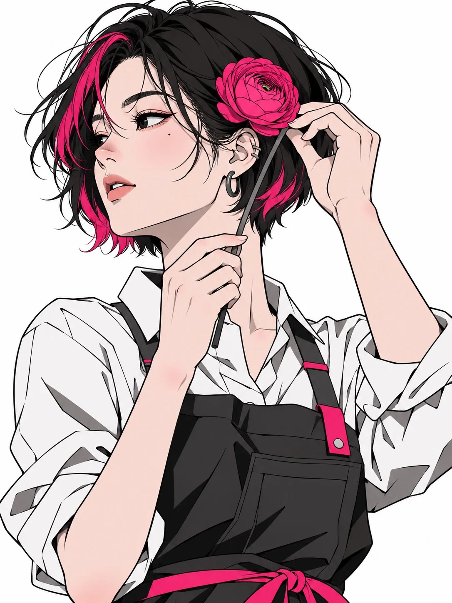

# Single-Accent Street Cel Illustration: Florist with a Ranunculus (3:4)

**中文标题：** 单主色街头赛璐珞插画：别花的花店店员（3:4）  
**ID:** `gi25-x-1541` · **Mode:** `generate`  
**Categories:** `general`  
**Tags:** `x-twitter`, `community`, `gpt-image-2.5`, `x-direct`, `zh`



### Single-Accent Street Cel Illustration: Florist with a Ranunculus (3:4)

```text
Create an image with the following visual system. Replace the subject as specified.

Visual system (light, color, composition, medium, mood):
【画面风格】一张竖幅约 3:4 的二维数字手绘街头插画：极细、锐利的黑线勾轮廓，颜色是硬边赛璐珞平涂，几乎没有柔和的晕染，只有面颊或关节处允许一点点喷枪似的腮红。背景是大面积纯白或极浅灰的留白，没有复杂场景，顶多在边缘留一点衣角、头发或饰品的出画。构图是近景半身或近胸特写，人物的手必须参与动作（整理头发、把玩小物件、插在口袋、扶着一根带子），手的结构要清楚。色彩系统非常克制：整张以黑、白、深灰为骨架，只给角色一个主色（以及这个主色的两三个深浅），不要再引入第二种高饱和颜色。主色用在头发的局部、衣服色块、饰品或指甲上，形成完整的视觉系统。不要画现成的游戏或动漫角色，不要可识别的商标和文字，不要签名和水印。气质干净、现代、有街头运动感，但不靠脏污和做旧。

New subject:
【主体】一个短发的花店店员，成年，脸是原创的，不是任何现成角色。主色是玫粉。她侧过身，一只手把一枝洋牡丹别到耳后，另一只手还拈着花茎，穿着深色工作围裙，袖口挽起来，围裙带上有一点玫粉。白底，近胸特写。
```

- **Recommended model:** `gpt-image-2.5-sunburst`
- **Settings:** _(defaults)_
- **Source:** [community](https://x.com/static_stare/status/2121577854626353379) — @static_stare
- **License note:** Original public X post; quoted with attribution — remix with attribution
- **Notes:** Collected directly from X; original post https://x.com/static_stare/status/2121577854626353379; post text names GPT Image 2.5; discovered via X search, prompt re-verified against the original X post via api.fxtwitter.com; verified=True; visual-system + replaceable-subject template; prompt for image 1 of 4 (the author offers the other three on request); post names GPT Image 2.5 without a Flare/Sunburst variant; preview is image 1
- **Preview:** `previews/gi25-x-1541.webp`
