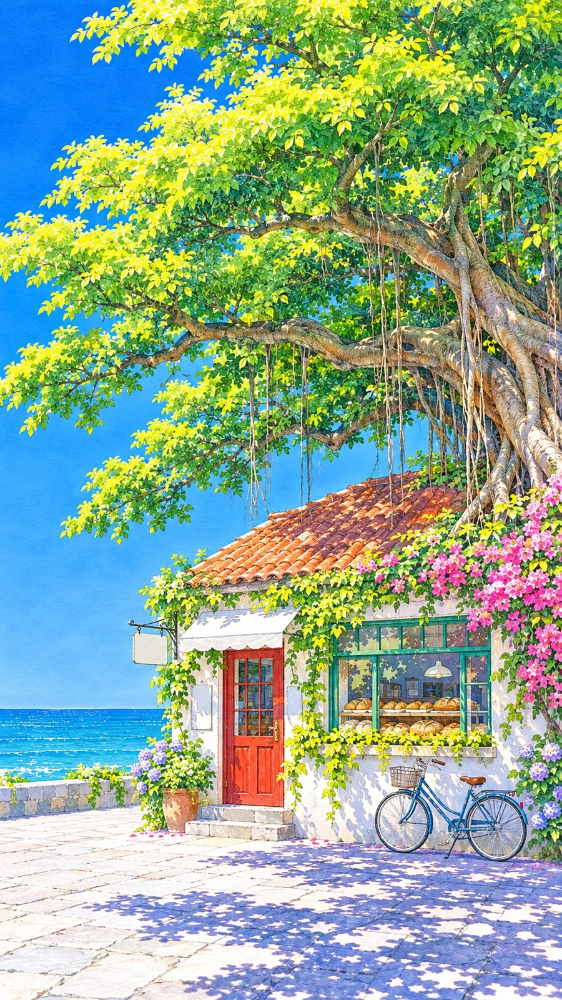

# Bright Japanese-Style Illustration: Seaside Bakery Under a Banyan (9:16)

**中文标题：** 明亮日系插画：榕树下的海边面包房（9:16）  
**ID:** `gi25-x-1543` · **Mode:** `generate`  
**Categories:** `general`  
**Tags:** `x-twitter`, `community`, `gpt-image-2.5`, `x-direct`, `zh`



### Bright Japanese-Style Illustration: Seaside Bakery Under a Banyan (9:16)

```text
Create an image with the following visual system. Replace the subject as specified.

Visual system (light, color, composition, medium, mood):
【画面风格】一张竖幅约 9:16 的明亮日系环境插画，像绘本封面或手机壁纸。天空是饱和干净的钴蓝到天青，几乎没有云，占上方近一半；一棵枝叶繁茂的大树从画面一侧压进来，树冠占上半张，用密集的细笔触一层层堆出叶丛，嫩绿和黄绿为主，受光处泛柠檬黄，暗处偏深绿。树冠下方、画面下三分之一是一处小小的临街店面，墙面被藤蔓和花丛半包住，门窗用饱和的对比色（朱红、青绿）点出来，店前有一小块明亮的铺地，地上落着蓝紫色的树影。光线是晴朗上午到中午的直射光，阴影清冷偏蓝紫，高光干净；整体色彩明快、对比强，像矿物水彩加细密排线。不要照片感、不要 3D、不要赛博光效、不要人物近景，不要可读文字，招牌只留色块或空白，不要品牌和 logo。清透、安静，中午前后的一段空白时间。

New subject:
【主体】海边的一间小面包房。一棵很老的榕树从右边压下来，树干粗，气根垂着。面包房是白墙，屋顶是砖红瓦，窗台上爬满黄绿的藤，门是朱红色，橱窗里一排面包。门前一块白石板地，一个蓝色的自行车靠在墙边。远处是一条平直的海平线，天空空着。
```

- **Recommended model:** `gpt-image-2.5-sunburst`
- **Settings:** _(defaults)_
- **Source:** [community](https://x.com/static_stare/status/2121923766074630447) — @static_stare
- **License note:** Original public X post; quoted with attribution — remix with attribution
- **Notes:** Collected directly from X; original post https://x.com/static_stare/status/2121923766074630447; post text names GPT Image 2.5; discovered via X search, prompt re-verified against the original X post via api.fxtwitter.com; verified=True; visual-system + replaceable-subject template; prompt for image 1 of 4 (the author offers the other three on request); post names GPT Image 2.5 without a Flare/Sunburst variant; preview is image 1
- **Preview:** `previews/gi25-x-1543.webp`
