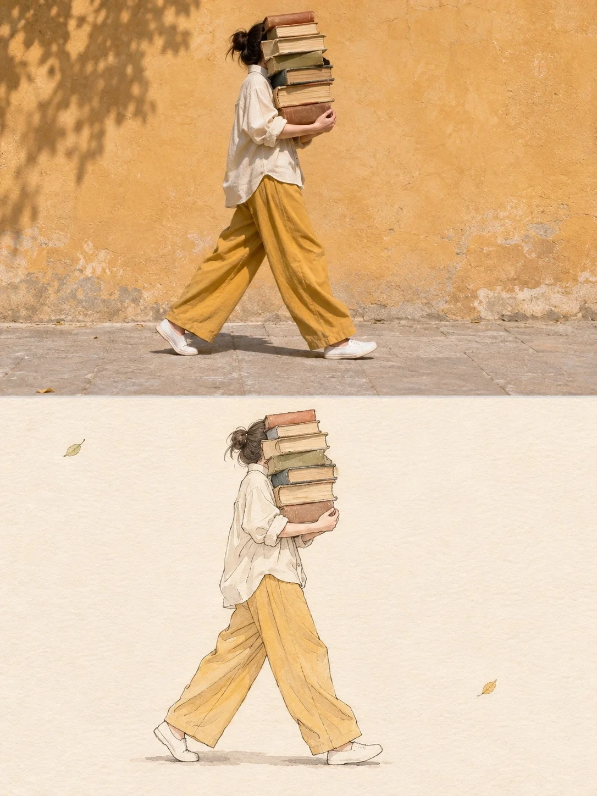

# Photo-over-Sketch Diptych: Carrying Old Books, Ink Line and Wash (3:4)

**中文标题：** 上照片下手绘双联：抱旧书走过黄墙（3:4）  
**ID:** `gi25-x-1544` · **Mode:** `generate`  
**Categories:** `general`, `character-consistency`  
**Tags:** `x-twitter`, `community`, `gpt-image-2.5`, `x-direct`, `zh`



### Photo-over-Sketch Diptych: Carrying Old Books, Ink Line and Wash (3:4)

```text
Create an image with the following visual system. Replace the subject as specified.

Visual system (light, color, composition, medium, mood):
【画面风格】一张竖幅约 3:4 的上下双联画面，上下各占一半，中间有一条很细的分隔。上半是一张阳光充足的实景照片：简单的纯色墙面或地面做背景，一个人物侧向或正向走过（或短暂停留），面部被自己手里抱着的较大物件挡住，看不清五官；衣服和物件的颜色清楚，光是白天的自然光，投影短而实。下半是同一瞬间的手绘转写，画在一张米色、带轻微纸纹的画纸上：用自然抖动的细墨线勾轮廓和衣褶，再铺一层很淡的水彩，颜色跟着照片走但更薄、更干净；人物脚下有一小块淡淡的接触阴影；空白处点缀两三朵很小的手绘小花、一片叶子或一只小蝴蝶，只做点缀不要抢主体。上下两半必须是同一个姿势、同一套衣服和同一件被抱着的物件，位置左右对齐。画面无水印、无签名、无社交账号、无「prompt」字样，物件和衣服上不要出现可读的文字或品牌。轻松、干净，像把一张生活照随手画进速写本。

New subject:
【主体】一个穿米白衬衫和姜黄宽裤的人，从左走向右，怀里抱着一摞高低不齐的旧书，书挡住了脸，走过一面土黄色的墙，脚上是白色平底鞋。下半画纸空白处点两片小叶子。画面中没有文字。
```

- **Recommended model:** `gpt-image-2.5-sunburst`
- **Settings:** _(defaults)_
- **Source:** [community](https://x.com/static_stare/status/2121146342152249406) — @static_stare
- **License note:** Original public X post; quoted with attribution — remix with attribution
- **Notes:** Collected directly from X; original post https://x.com/static_stare/status/2121146342152249406; post text names GPT Image 2.5; discovered via X search, prompt re-verified against the original X post via api.fxtwitter.com; verified=True; visual-system + replaceable-subject template; prompt for image 1 of 4 (the author offers the other three on request); post names GPT Image 2.5 without a Flare/Sunburst variant; preview is image 1
- **Preview:** `previews/gi25-x-1544.webp`
