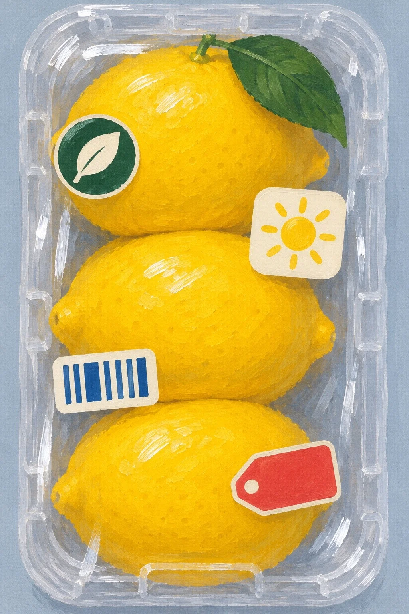

# Gouache Grocery Pack: Three Lemons in a Clear Box (2:3)

**中文标题：** 水粉生鲜盒：透明盒里的三个柠檬（2:3）  
**ID:** `gi25-x-1546` · **Mode:** `generate`  
**Categories:** `general`  
**Tags:** `x-twitter`, `community`, `gpt-image-2.5`, `x-direct`, `zh`



### Gouache Grocery Pack: Three Lemons in a Clear Box (2:3)

```text
Create an image with the following visual system. Replace the subject as specified.

Visual system (light, color, composition, medium, mood):
【画面风格】一张竖幅约 2:3 的手绘水粉插画，正面略俯视看一只透明塑料包装盒，盒子竖着放，几乎占满画面，里面从上到下紧紧叠着三个同一种的果蔬或食物，个头饱满，刚好挤满盒子。塑料盒用白色干刷笔触画出反光条和压痕，盒边是一圈半透明的浅灰，能透出后面的浅灰蓝底色。食物用厚水粉一笔一笔堆出体积：亮面有几道短短的白色高光，暗面压一点同色系的深色，边缘偶尔干刷露底。盒子表面贴着四枚小贴纸：一枚圆形贴纸、一枚小方形贴纸、一条条码贴、一枚价签形状的小贴纸。贴纸只画成纯色块、细边框和简单小图标（叶子、太阳、小房子、对勾），贴纸上不写任何字母、汉字、数字和价格，条码只是几道竖线。光线是均匀柔和的顶光，略偏冷，投影很淡。色彩：浅灰蓝底占大面积，食物是饱和的主色，贴纸用奶白、墨绿、深蓝和一点红做点缀。不要照片感，不要 3D，不要真实品牌和 logo，不要任何可读文字。干净、有手感，像超市冷柜里刚补好货的一盒。

New subject:
【主体】三个黄柠檬竖着叠在盒里，表皮有细小的坑点，最上面一个连着一片深绿的叶子。贴纸：墨绿圆贴纸上画一片白色小叶子，奶白方贴纸上画一个黄色小太阳，一条条码贴，一枚红色价签形状的小贴纸，全都没有字。
```

- **Recommended model:** `gpt-image-2.5-sunburst`
- **Settings:** _(defaults)_
- **Source:** [community](https://x.com/static_stare/status/2122188460622856197) — @static_stare
- **License note:** Original public X post; quoted with attribution — remix with attribution
- **Notes:** Collected directly from X; original post https://x.com/static_stare/status/2122188460622856197; post text names GPT Image 2.5; discovered via X search, prompt re-verified against the original X post via api.fxtwitter.com; verified=True; visual-system + replaceable-subject template; prompt for image 1 of 4 (the author offers the other three on request); post names GPT Image 2.5 without a Flare/Sunburst variant; preview is image 1
- **Preview:** `previews/gi25-x-1546.webp`
