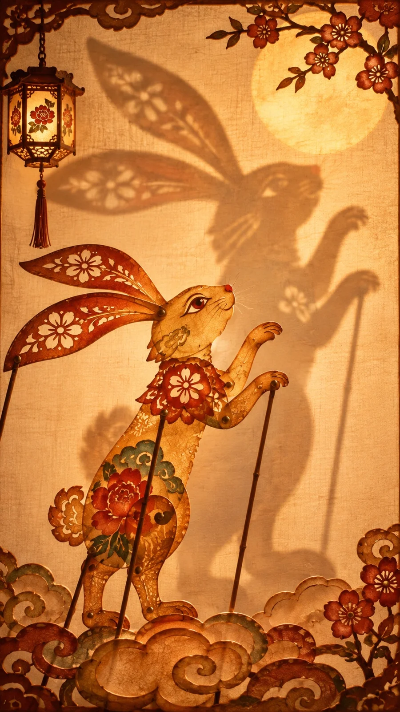

# Warm-Lit Shadow Puppet: Rabbit Reaching for the Moon (9:16)

**中文标题：** 暖光皮影静帧：探月的兔子（9:16）  
**ID:** `gi25-x-1547` · **Mode:** `generate`  
**Categories:** `general`  
**Tags:** `x-twitter`, `community`, `gpt-image-2.5`, `x-direct`, `zh`



### Warm-Lit Shadow Puppet: Rabbit Reaching for the Moon (9:16)

```text
Create an image with the following visual system. Replace the subject as specified.

Visual system (light, color, composition, medium, mood):
【画面风格】一张竖幅约 9:16 的皮影戏静帧：前景是一件用半透明彩绘皮革制成的精密皮影偶，关节处有小小的金属铆钉，四肢或部件由细杆支撑，皮子被背后的暖黄光照透，能看见厚度、镂空花纹和淡淡的皮质纹理。偶的轮廓是侧影或四分之三侧，姿态清楚，细节靠镂空和描绘完成，不要画成普通插画人物，不要写实皮肤。背景是一块被暖光照亮的米白或浅杏色幕布，幕布上投出同一个主体的更大、稍软的影子，影子可以和偶的动作有一点点错位，形成前后两层。四周可以有传统的皮革边框、云纹、花卉或小型陪衬皮影，以及一盏透光的提灯，但这些都是配角，不要写字、不要匾额文字、不要款识。配色以暖黄、琥珀、赭石为主，主体皮革可带少量靛蓝、朱红或石绿的透明彩绘，暗处是深褐。光线来自幕布后方偏上的暖光，前面的偶是被照透的，影子投在幕上。质感是真实的手工皮革雕刻和剧场灯光，不要 3D 塑料感，不要日出风景照，不要现代舞台LED。安静、像一场还没开演的夜戏。画面无文字、无签名、无品牌、无现成角色。

New subject:
【主体】主体是一只侧身立起的兔子皮影，耳朵很长，前爪抬起，像在探月亮。皮革是暖黄和浅赭，耳朵和胸口有简单的镂空花。幕布上是它的大影子，影子里耳朵特别长。左上可以有一盏小提灯，脚下是云纹皮雕。没有人物。
```

- **Recommended model:** `gpt-image-2.5-sunburst`
- **Settings:** _(defaults)_
- **Source:** [community](https://x.com/static_stare/status/2121607659661222001) — @static_stare
- **License note:** Original public X post; quoted with attribution — remix with attribution
- **Notes:** Collected directly from X; original post https://x.com/static_stare/status/2121607659661222001; post text names GPT Image 2.5; discovered via X search, prompt re-verified against the original X post via api.fxtwitter.com; verified=True; visual-system + replaceable-subject template; prompt for image 1 of 4 (the author offers the other three on request); post names GPT Image 2.5 without a Flare/Sunburst variant; preview is image 1
- **Preview:** `previews/gi25-x-1547.webp`
