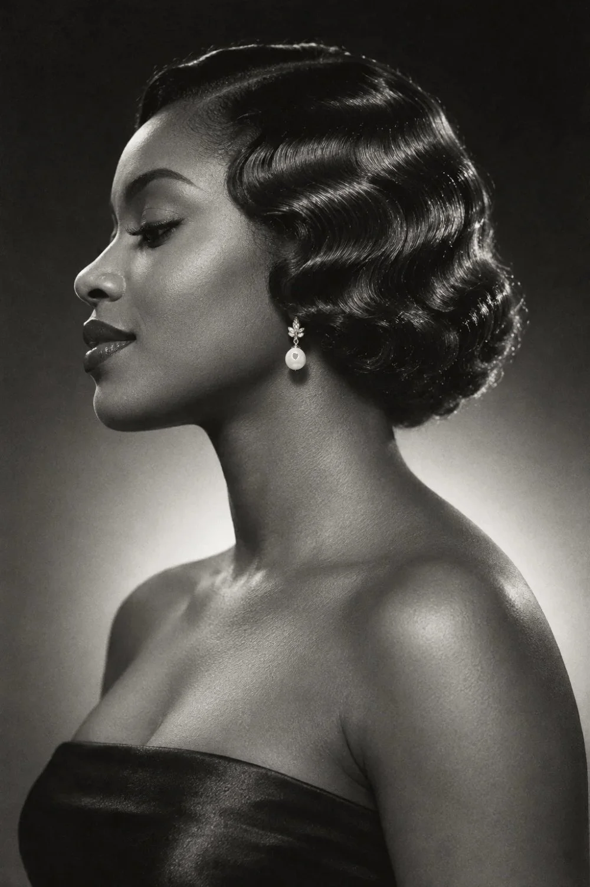

# 1930s Finger-Wave Bob, Black-and-White Studio Profile

**中文标题：** 1930 年代手推波浪短发黑白棚拍侧颜  
**ID:** `gi25-x-1556` · **Mode:** `generate`  
**Categories:** `general`  
**Tags:** `x-twitter`, `community`, `gpt-image-2.5`, `x-direct`, `en`



### 1930s Finger-Wave Bob, Black-and-White Studio Profile

```text
A sculpted finger-wave bob sits high in a vintage black-and-white studio photograph, just below a band of near-black backdrop above her crown: glossy jet-black hair set in tight 1930s-style ridges that sweep back from a deep side part and curl under at the jawline, every ridge of each wave catching its own bright silver highlight. The sitter, a West African woman in her thirties, is held in strict side profile facing the left edge of the frame, chin lifted, eyes lowered beneath long dark lashes in a soft, dreamy half-close, lips closed and dark with the corners turned faintly up into a small private smile. A pearl-and-gold drop earring hangs free below her ear, the pearl and its small gold cap throwing tiny sparkles of light. Her deep brown skin reads as smooth polished silver-grey, luminous along the cheekbone, the jaw and the throat, and the long curve of her neck flows down into a bare shoulder, the main line leading through the picture, above the straight neckline of a strapless black satin gown sitting low across the bottom edge, its sheen a soft band of grey. Crisp white studio key light falls from high in front of her face and carves the waves and the profile with clean edges. Behind her the backdrop is velvety near-black at the top and grades down to a soft pale glow behind her shoulder that rims the nape and the curled ends of the bob. Fine film grain throughout, deep inky blacks, silvery whites, no colour.
```

- **Recommended model:** `gpt-image-2.5-sunburst`
- **Settings:** _(defaults)_
- **Source:** [community](https://x.com/aiartalley/status/2122042092448829864) — @aiartalley
- **License note:** Original public X post; quoted with attribution — remix with attribution
- **Notes:** Collected directly from X; prompt posted as the author's own reply https://x.com/aiartalley/status/2122042092448829864 to https://x.com/aiartalley/status/2122042088766275589, which carries the images; GPT Image 2.5 is named in the parent post; discovered via X search, prompt re-verified against the original X post via api.fxtwitter.com; verified=True; the parent post compares four models; image 2 is GPT Image 2.5 Sunburst and is used as the preview
- **Preview:** `previews/gi25-x-1556.webp`
