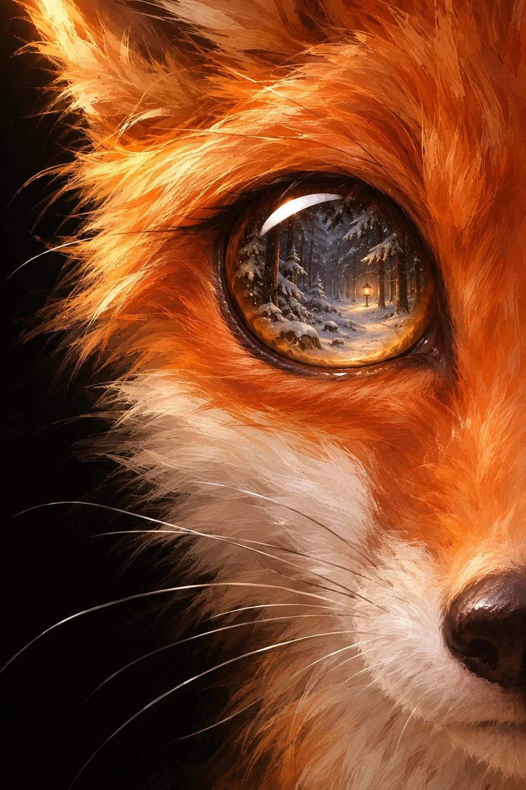

# Thick-Paint Close-Up: A Red Fox's Eye Holding a Snowy Pine Path (2:3)

**中文标题：** 厚涂特写：赤狐眼里的下雪松林（2:3）  
**ID:** `gi25-x-1562` · **Mode:** `generate`  
**Categories:** `general`  
**Tags:** `x-twitter`, `community`, `gpt-image-2.5`, `x-direct`, `zh`



### Thick-Paint Close-Up: A Red Fox's Eye Holding a Snowy Pine Path (2:3)

```text
Create an image with the following visual system. Replace the subject as specified.

Visual system (light, color, composition, medium, mood):
【画面风格】一张竖幅约 2:3 的数字厚涂特写插画。动物的半边脸从画面一侧压进来，出血裁切，只看得到一只眼睛、一部分鼻子和脸颊，眼睛放在画面中间偏上，又大又圆，约占画面三分之一。毛发用很多细长的笔触一缕一缕画出来，边缘松散，方向顺着脸的结构走，几根细白的胡须或长毛伸出画外。重点在眼睛：虹膜像一颗透亮的玻璃球，里面清楚地映出一个和这只动物有关的微缩小场景，场景有前后景和自己的光，眼睛上方有一道弧形的白色高光，下眼睑有一点湿润的反光。背景是接近纯黑的深色，和暖色毛发形成强烈的明暗对比，另一侧大面积留黑。光线是上方偏左的暖光，照亮额头和眼周，暗部沉进黑底。色彩：毛发以暖橙、焦糖、奶白为主，背景黑，眼里的小世界用它自己的颜色，是整张最精细、最亮的地方。笔触清楚，像平板上的厚涂，不要照片，不要 3D 毛发渲染，不要卡通大头，不要文字和签名。

New subject:
【主体】一只赤狐的半边脸，橙红色的毛，白色的脸颊和细长的白胡须。琥珀色的眼睛里映着一片正在下雪的松林，林间一条小路，路尽头一盏很小的暖灯。
```

- **Recommended model:** `gpt-image-2.5-flare`
- **Settings:** _(defaults)_
- **Source:** [community](https://x.com/static_stare/status/2122234606862639271) — @static_stare
- **License note:** Original public X post; quoted with attribution — remix with attribution
- **Notes:** Collected directly from X; original post https://x.com/static_stare/status/2122234606862639271; post text names GPT Image 2.5; discovered via X search, prompt re-verified against the original X post via api.fxtwitter.com; verified=True; visual-system + replaceable-subject template; prompt for image 1 of 4 (the author offers the other three on request); post names GPT Image 2.5 without a Flare/Sunburst variant; preview is image 1
- **Preview:** `previews/gi25-x-1562.webp`
