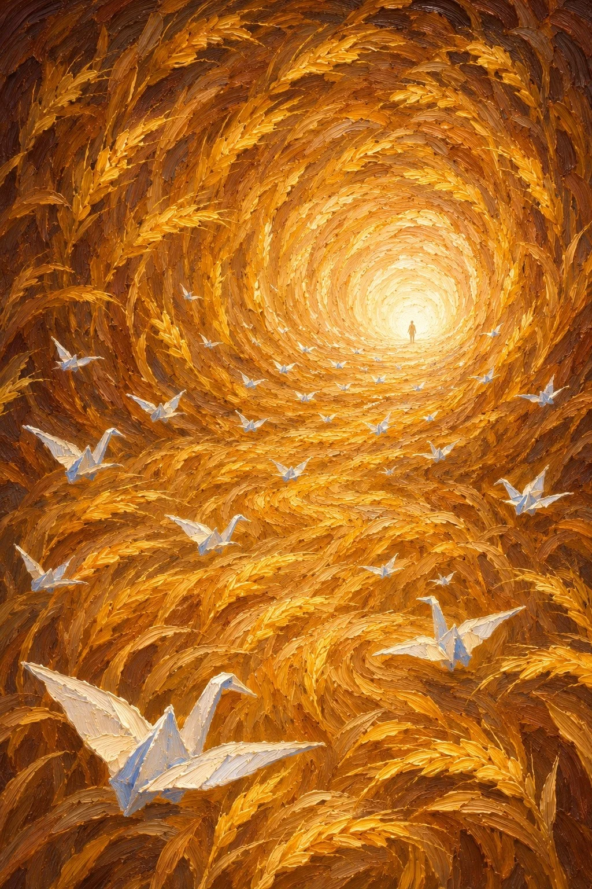

# Brushstroke Vortex: Walking into Golden Wheat and Paper Cranes (2:3)

**中文标题：** 笔触漩涡：走进金色麦浪与纸鹤的光（2:3）  
**ID:** `gi25-x-1565` · **Mode:** `generate`  
**Categories:** `general`  
**Tags:** `x-twitter`, `community`, `gpt-image-2.5`, `x-direct`, `zh`



### Brushstroke Vortex: Walking into Golden Wheat and Paper Cranes (2:3)

```text
Create an image with the following visual system. Replace the subject as specified.

Visual system (light, color, composition, medium, mood):
【画面风格】一张竖幅约 2:3 的厚涂油画风超现实插画，整张都由密集、短而弯的笔触组成，像旋转的油画笔法。画面是一条向远处收缩的螺旋隧道：四周的笔触沿着同心漩涡一圈圈旋进画面中上部的尽头，尽头是一团最亮的光。光里站着一个很小的人物背影剪影，只有指甲盖大小，看不清脸和衣服。下半部分的地面也是旋转笔触，一路向前景铺开，前景到中景飞满许多小小的飞行物，越靠近镜头越大越清楚，颜色和主色形成撞色点缀。机位是略低的平视，透视向尽头强烈收束，纵深很深。光只来自隧道尽头，越往四周越暗，笔触边缘带一点光。色彩：主色占大面积，从尽头的浅亮色过渡到边缘的深色，飞行物是少量高饱和的撞色。颜料厚度和笔触方向都看得见，不要照片，不要 3D，不要平滑渐变，不要文字。安静，像走进一个晚上的梦。

New subject:
【主体】主色是金色麦浪：隧道四周是一圈圈金黄、琥珀、赭石的麦浪笔触，边缘压到深褐，尽头是暖白的光。飞的是许多小小的白色纸鹤，带一点淡蓝的影子。
```

- **Recommended model:** `gpt-image-2.5-flare`
- **Settings:** _(defaults)_
- **Source:** [community](https://x.com/static_stare/status/2122301461925433729) — @static_stare
- **License note:** Original public X post; quoted with attribution — remix with attribution
- **Notes:** Collected directly from X; original post https://x.com/static_stare/status/2122301461925433729; post text names GPT Image 2.5; discovered via X search, prompt re-verified against the original X post via api.fxtwitter.com; verified=True; visual-system + replaceable-subject template; prompt for image 1 of 4 (the author offers the other three on request); post names GPT Image 2.5 without a Flare/Sunburst variant; preview is image 1
- **Preview:** `previews/gi25-x-1565.webp`
