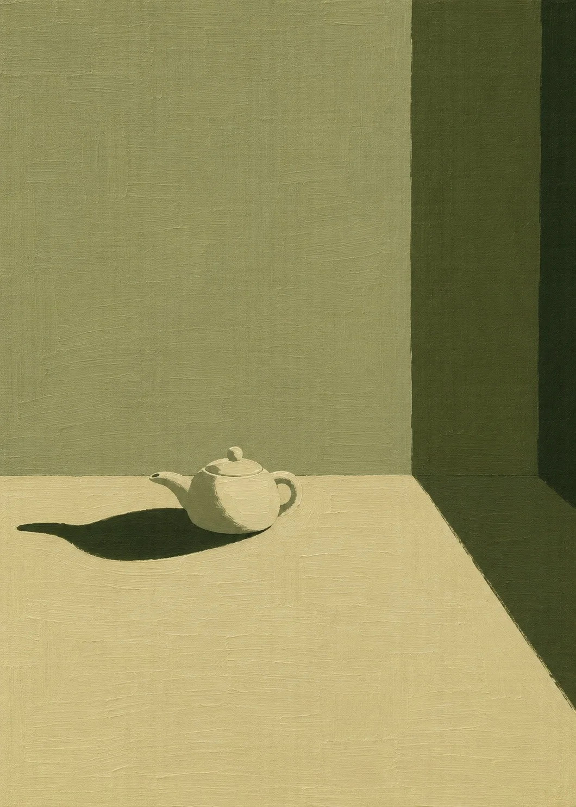

# Minimal Oil Still Life: A White Teapot and Its Long Shadow (5:7)

**中文标题：** 极简油画静物：白瓷茶壶与长影子（5:7）  
**ID:** `gi25-x-1568` · **Mode:** `generate`  
**Categories:** `general`  
**Tags:** `x-twitter`, `community`, `gpt-image-2.5`, `x-direct`, `zh`



### Minimal Oil Still Life: A White Teapot and Its Long Shadow (5:7)

```text
Create an image with the following visual system. Replace the subject as specified.

Visual system (light, color, composition, medium, mood):
【画面风格】一张竖幅约 5:7 的极简油画静物，用平涂的厚颜料画在有细布纹的画布上，笔触平而可见，整张只有一个色系的四五个明度。画面是一个墙角：上半是一面浅橄榄灰绿的墙，右侧是一块竖向的深橄榄绿墙面和更深的转角，形成清楚的几何分割；下半是一张奶黄偏米白的桌面，一直铺到画面下缘，右侧被一道斜向的深绿阴影切掉一角。桌面中间偏左放着一件很小的日常器物，器物本身几乎和桌面同色，只靠轮廓和一点暗部读出来；它在桌面上投下一大块边缘清楚的深墨绿影子，影子比器物大，形状被拉长、有点夸张，是画面的主角。光线是右前方来的单一硬光，没有别的光源，明暗分界干脆。色彩只用浅橄榄、奶黄、深橄榄绿和近黑的墨绿，不要别的颜色。留白很多，器物只占画面很小一块。不要照片，不要 3D，不要细节纹理和装饰图案，不要文字和签名。很安静，像深夜一个人坐在桌边看到的角落。

New subject:
【主体】一只矮胖的白瓷茶壶，壶嘴朝左，壶盖上一颗小圆钮，影子把壶嘴拉得很长，斜斜地铺向左边。
```

- **Recommended model:** `gpt-image-2.5-flare`
- **Settings:** _(defaults)_
- **Source:** [community](https://x.com/static_stare/status/2122330798116516312) — @static_stare
- **License note:** Original public X post; quoted with attribution — remix with attribution
- **Notes:** Collected directly from X; original post https://x.com/static_stare/status/2122330798116516312; post text names GPT Image 2.5; discovered via X search, prompt re-verified against the original X post via api.fxtwitter.com; verified=True; visual-system + replaceable-subject template; prompt for image 1 of 4 (the author offers the other three on request); post names GPT Image 2.5 without a Flare/Sunburst variant; preview is image 1
- **Preview:** `previews/gi25-x-1568.webp`
