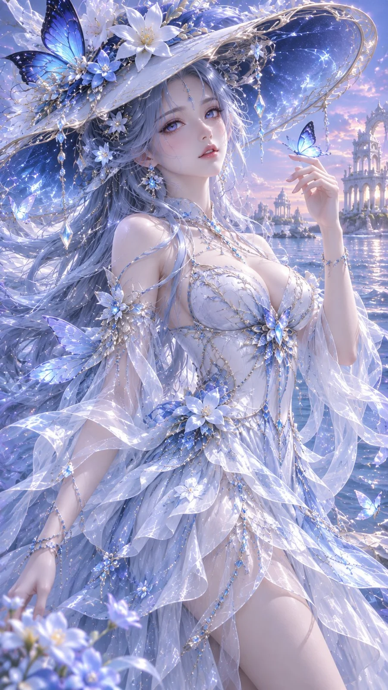

# Stylized 3D CG Character Poster: Shore Keeper, Sea-Sanctuary Spirit (9:16)

**中文标题：** 风格化 3D CG 角色海报：守岸人（9:16）  
**ID:** `gi25-x-1569` · **Mode:** `generate`  
**Categories:** `general`  
**Tags:** `x-twitter`, `community`, `gpt-image-2.5`, `x-direct`, `zh`



### Stylized 3D CG Character Poster: Shore Keeper, Sea-Sanctuary Spirit (9:16)

```text
9:16 竖版，高精度风格化 3D CG 东方幻想女性角色海报，semi-realistic anime-style 3D character render，high-end oriental fantasy sea spirit character design，premium cinematic CG portrait。

画面主体是一位明确成年的东方幻想女性，视觉年龄约 22–26 岁，身份如同海上圣域与月光蝶灵共同孕育的高贵灵姬 / 花灵圣女。整体气质清冷、优雅、轻盈、梦幻、神秘，带有安静而高贵的东方幻想感。整体不是普通二次元插画，也不是人偶或手办，而是具有生命感的高精度风格化 3D CG 东方幻想角色原型。

人物拥有精致柔美的东方动漫化五官，小巧流畅的鹅蛋脸，冷白通透的肌肤，皮肤细腻柔和，带高级次表面散射。眼睛清澈明亮，瞳色带浅蓝与淡紫高光，眼尾自然拉长，睫毛纤长，目光安静轻柔，神态从容含蓄。鼻梁秀气挺直，嘴唇小巧柔润，唇色为淡粉冷调。整体五官保持高级、清透、空灵的东方幻想美感，不幼态，不网红化。

人物拥有大量冰蓝色、月光蓝与浅天蓝交织的中长至长发，发丝蓬松轻盈，带自然微卷和空气感，部分刘海与发束轻轻垂落在脸侧，更多发丝被海风吹拂，在肩后和身体四周柔和飘散。头发边缘具有细腻透光、高光与柔和辉光。

服装为高精度 3D CG 东方幻想灵蝶礼装，整体以月白、珍珠白、冰蓝与浅雾蓝为主。上身为修身结构的东方幻想礼裙，融合花瓣式剪裁、蝴蝶羽翼语言与轻薄透明薄纱层次，胸前、肩部、腰间与裙摆加入精致金属扣件、宝石链饰、灵花纹样与蝶翼细节。裙装下摆采用不规则多层花瓣与薄纱堆叠，轻盈灵动，边缘如海风中的花瓣般翻卷。材质表现为丝绸、雪纺、欧根纱与半透明灵纱，具有高级柔光反射与通透层次。

人物头戴一顶华丽而巨大的东方幻想宽檐礼帽，帽体以月白色为主，帽檐边缘带细腻金边，帽内衬为深海蓝与星空蓝渐变，具有星海般的深邃发光质感。帽饰由白色灵花、大型蓝黑渐变蝶翼与细小装饰组成，既华美又具有神秘感，是画面的重要识别点。

人物身体微侧站立，采用大腿以上近景构图，脸部位于画面左上至中上区域，成为第一视觉中心。她轻轻抬起一只手，修长的手指与一只停驻其上的发光蓝色灵蝶形成第二视觉中心。另一只手自然垂落，姿态优雅舒展。整体动作轻盈、安静、从容，带有海风中的灵性气息。

背景为海上圣域黄昏景象：平静清澈的海面反射天空与灵光，远处矗立着白色古代神殿般的海边遗迹与拱门建筑，带有空灵而神圣的东方幻想圣域气息。天空为明亮通透的蓝天与浅粉紫晚霞交织，海天之间弥漫细腻光雾。周围漂浮少量发光灵蝶、微光粒子与极淡灵气，使场景更具梦境感。

光影采用电影级梦幻柔光设计：主要光源来自天空上方与海面的反射天光，柔和地照亮人物脸部、肩颈、胸前、手臂和帽檐；海面、薄纱与周围灵蝶提供细腻冷白补光，使阴影保持干净通透；头发边缘、帽檐、肩线和飘带拥有柔和的轮廓光。整体光线明亮清透、轻盈柔和，并带轻微 bloom 和 halation，形成高级梦幻的 CG 发光氛围。

色彩采用清澈高级的蓝白幻想体系：冰蓝、天蓝、月白、珍珠白为主色，深海蓝作为局部结构锚点，远处天空与水面可出现少量粉紫霞光作为柔和氛围色，少量金色仅用于边缘点缀和首饰细节。整体配色明亮、通透、干净、轻盈、鲜活而不俗，避免灰蒙、脏黄和整图同色罩染。

空气中可漂浮少量发光蝴蝶、灵花碎片、细小光点与柔和粒子，增强梦幻感，但数量克制，不显杂乱。画面整体呈现高完成度、唯美、通透、沉浸式的东方幻想 3D CG 角色海报质感。

high-density hair strands, subsurface scattering skin, translucent fantasy fabric, luminous butterflies, sea sanctuary ruins, twilight ocean glow, elegant fantasy hat, layered petal dress, cinematic soft light, premium game character render, ultra-detailed 3D CG, no text, no logo, no watermark
```

- **Recommended model:** `gpt-image-2.5-flare`
- **Settings:** _(defaults)_
- **Source:** [community](https://x.com/liyue_ai/status/2122360041919685073) — @liyue_ai
- **License note:** Original public X post; quoted with attribution — remix with attribution
- **Notes:** Collected directly from X; original post https://x.com/liyue_ai/status/2122360041919685073; post text names GPT Image 2.5; discovered via X search, prompt re-verified against the original X post via api.fxtwitter.com; verified=True; post names GPT Image 2.5 without a Flare/Sunburst variant
- **Preview:** `previews/gi25-x-1569.webp`
