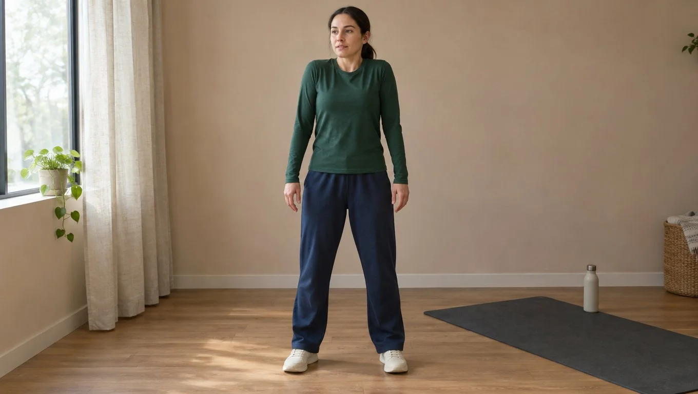

# Photoreal Fitness Documentary Still: Shoulder-Roll Warm-Up at Home (16:9)

**中文标题：** 照片级健身纪实静帧：家中转肩热身（16:9）  
**ID:** `gi25-x-1571` · **Mode:** `generate`  
**Categories:** `general`  
**Tags:** `x-twitter`, `community`, `gpt-image-2.5`, `x-direct`, `en`



### Photoreal Fitness Documentary Still: Shoulder-Roll Warm-Up at Home (16:9)

```text
Create one photorealistic horizontal 16:9 fitness documentary still. A wholly fictional athletic woman in her thirties is warming up in a modest home exercise room. She wears an opaque forest-green long-sleeve training shirt, loose navy track pants and plain cream trainers. Her dark hair is tied in a low ponytail. She looks slightly beyond the camera with a focused, relaxed expression, without beauty styling.

Capture a single shoulder-roll warm-up moment from the source routine: she stands with feet comfortably apart, knees relaxed, arms loose beside her body and shoulders gently lifted. Use an eye-level full-body tripod composition with her hands and shoes fully visible. This is one frozen moment, not a motion sequence or a diagram of exercise instructions.

The room has a pale clay wall, a large side window with a simple linen curtain, a charcoal exercise mat and one plain water bottle on the floor. Remove mirrors so there is only one visible figure. Soft morning window light creates believable shadows, fine cotton texture and natural skin detail. Forest green and navy contrast with clay and cream. Use restrained photographic grain and ordinary home-video immediacy without a timestamp or interface overlay.

Keep anatomy natural and weight balanced over the feet. No gym branding, smartwatch screen, captions, logos, watermarks, glamour pose, skin smoothing or extra people.
```

- **Recommended model:** `gpt-image-2.5-flare`
- **Settings:** _(defaults)_
- **Source:** [community](https://x.com/Alyssa4aicreate/status/2122531259209429394) — @Alyssa4aicreate
- **License note:** Original public X post; quoted with attribution — remix with attribution
- **Notes:** Collected directly from X; original post https://x.com/Alyssa4aicreate/status/2122531259209429394; post text names GPT Image 2.5; discovered via X search, prompt re-verified against the original X post via api.fxtwitter.com; verified=True; made with Token360 · GPT Image 2.5 Flare; the post ends with the signature line 'Simply Ray'
- **Preview:** `previews/gi25-x-1571.webp`
