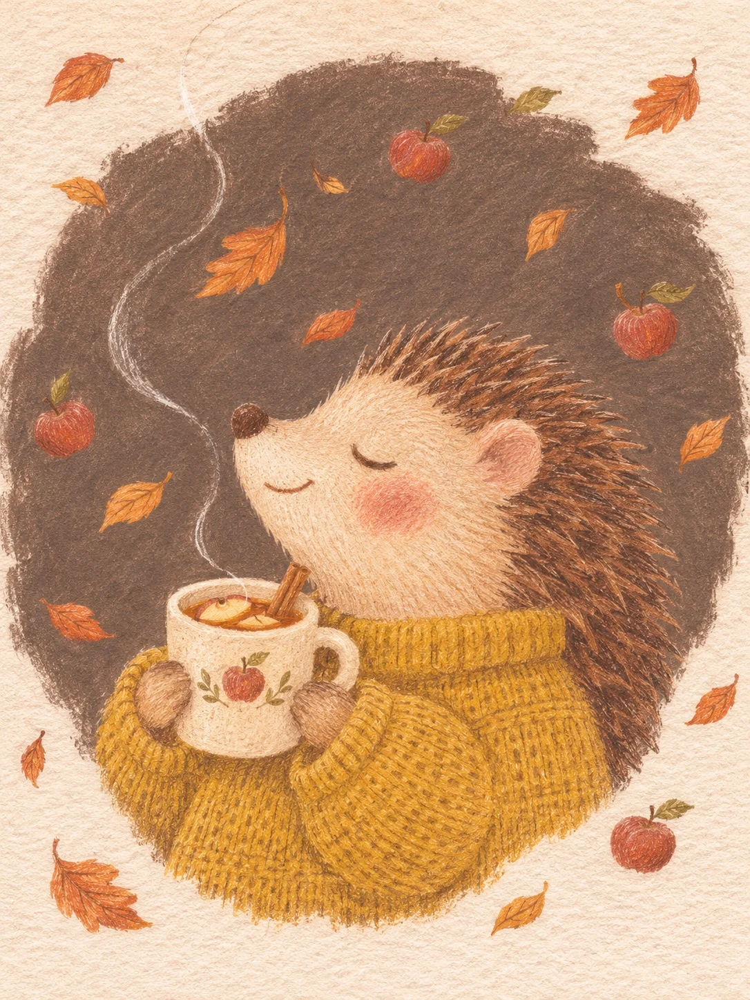

# Paper-Texture Picture-Book Animal: Hedgehog in a Mustard Sweater with Apple Tea (3:4)

**中文标题：** 纸感绘本小动物：芥末黄毛衣刺猬与苹果茶（3:4）  
**ID:** `gi25-x-1572` · **Mode:** `generate`  
**Categories:** `general`  
**Tags:** `x-twitter`, `community`, `gpt-image-2.5`, `x-direct`, `zh`



### Paper-Texture Picture-Book Animal: Hedgehog in a Mustard Sweater with Apple Tea (3:4)

```text
Create an image with the following visual system. Replace the subject as specified.

Visual system (light, color, composition, medium, mood):
【画面风格】一张竖幅约 3:4 的手绘绘本插画，像在带明显纹理的米白色水彩纸上用彩铅叠水粉画出来，纸纹到处透出来。画面中央是一块不规则的圆形深灰褐色色块，边缘柔软不齐，像宽笔刷一次刷出来的，四周留出一圈大片米白纸面。一只拟人化的小动物从画面下方入画，只画到胸口，侧身朝向画面左侧，闭着眼睛，嘴角微微笑，脸颊上一团粉红腮红，表情满足又放松。它穿一件粗针织毛衣，毛衣用密密的短竖线和细横线画出针脚，袖子是圆滚滚的简化形状，两只爪子从袖口露出来，捧着一只小热饮杯，杯口升起一缕用细白线勾出的弯曲热气，热气一半飘出色块落在纸面上。色块里和边缘散落着十几片小小的季节元素，每片用几笔彩铅线画出纹理，方向随意，像被风吹着打转。动物的毛用细密的彩铅短线一层层叠出来，边缘有手绘的轻微抖动。光线是平的，没有明确的投影，靠色块深浅和笔触出体积。色彩：米白纸面加深灰褐色块做底，动物和毛衣是主角，散落元素用暖橙、芥末黄、砖红、橄榄绿这类低饱和的秋冬色，整体温暖、安静、手作感很强。不要 3D，不要光滑矢量，不要照片质感，不要文字、签名和水印。

New subject:
【主体】一只浅棕色的小刺猬，背上的刺用一簇簇深棕色短线画出来，鼻头圆圆的。穿一件芥末黄的粗针毛衣，捧着一只奶白色马克杯，里面是冒热气的苹果茶。色块周围飘着橙红色的落叶和几颗小小的红苹果。
```

- **Recommended model:** `gpt-image-2.5-flare`
- **Settings:** _(defaults)_
- **Source:** [community](https://x.com/static_stare/status/2122551281491570939) — @static_stare
- **License note:** Original public X post; quoted with attribution — remix with attribution
- **Notes:** Collected directly from X; original post https://x.com/static_stare/status/2122551281491570939; post text names GPT Image 2.5; discovered via X search, prompt re-verified against the original X post via api.fxtwitter.com; verified=True; visual-system + replaceable-subject template; prompt for image 1 of 4 (the author offers the other three on request); post names GPT Image 2.5 without a Flare/Sunburst variant; preview is image 1
- **Preview:** `previews/gi25-x-1572.webp`
