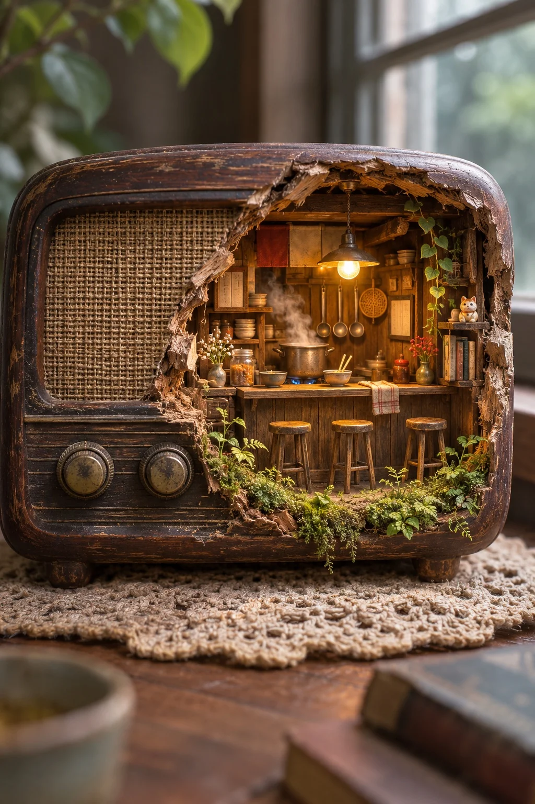

# Miniature Room Hidden Inside a Cutaway Vintage Radio (2:3)

**中文标题：** 剖开的旧收音机里藏着一间微缩小面馆（2:3）  
**ID:** `gi25-x-1573` · **Mode:** `generate`  
**Categories:** `general`  
**Tags:** `x-twitter`, `community`, `gpt-image-2.5`, `x-direct`, `zh`



### Miniature Room Hidden Inside a Cutaway Vintage Radio (2:3)

```text
Create an image with the following visual system. Replace the subject as specified.

Visual system (light, color, composition, medium, mood):
【画面风格】一张竖幅约 2:3 的微缩模型实拍照片，像放在窗边木桌上用微距镜头拍的一件手工微缩作品。画面中央是一个真实的日常物件，占画面高度约三分之二，它的一侧外壳被不规则地剖开、掀掉一大块，破口边缘是粗糙的断面，露出外壳的厚度和碎屑。从破口望进去，里面藏着一个完整、精细的微缩小房间，大约 1:24 的比例：有小家具、货架、摆件和细碎的生活痕迹，一盏很小的暖黄灯泡吊在里面亮着，是全画面最亮的点，暖光从洞口溢出，照亮破口的边缘。房间地面的边缘溢出一圈青苔和小植物，盖住下沿的断面，像从里面长出来的。物件下面有一个和它相配的底座或垫物。背景是窗边的家居环境，左上角有虚化的绿植叶子，右侧窗户透进柔和的自然光，背景用很浅的景深虚化成色块。色彩：物件外壳的旧质感颜色和深木色为主，内部是暖橙、琥珀、深棕的室内暖调，青苔一抹苔绿，窗外光偏冷灰绿，内暖外冷。质感：做旧漆面、木纹、金属的氧化痕迹、微缩布料和书本的细节都清楚，像真实拍摄的手工作品，不是 3D 渲染，不是插画。不要可读文字、标签、logo 和水印，小招牌和菜单只画色块。

New subject:
【主体】一台老式木壳收音机，正面的喇叭布和两个旋钮还在，右半边外壳被剖开。里面是一间深夜的小面馆：一条小木吧台和三张高脚凳，灶台上一口大汤锅正冒着白汽，墙上挂着一排汤勺和竹笊篱，一盏暖黄灯泡吊在吧台上方。收音机放在一块米色钩针小垫上。
```

- **Recommended model:** `gpt-image-2.5-flare`
- **Settings:** _(defaults)_
- **Source:** [community](https://x.com/static_stare/status/2122596204261576750) — @static_stare
- **License note:** Original public X post; quoted with attribution — remix with attribution
- **Notes:** Collected directly from X; original post https://x.com/static_stare/status/2122596204261576750; post text names GPT Image 2.5; discovered via X search, prompt re-verified against the original X post via api.fxtwitter.com; verified=True; visual-system + replaceable-subject template; prompt for image 1 of 4 (the author offers the other three on request); post names GPT Image 2.5 without a Flare/Sunburst variant; preview is image 1
- **Preview:** `previews/gi25-x-1573.webp`
