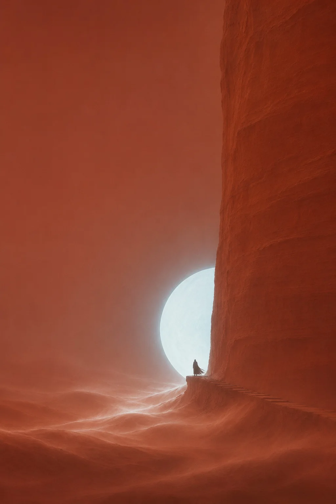

# Cinematic Cliff-Wall with a Pale Moon Behind a Cloaked Figure (2:3)

**中文标题：** 电影感峭壁：冷白巨月与斗篷人（2:3）  
**ID:** `gi25-x-1577` · **Mode:** `generate`  
**Categories:** `general`  
**Tags:** `x-twitter`, `community`, `gpt-image-2.5`, `x-direct`, `zh`



### Cinematic Cliff-Wall with a Pale Moon Behind a Cloaked Figure (2:3)

```text
Create an image with the following visual system. Replace the subject as specified.

Visual system (light, color, composition, medium, mood):
【画面风格】一张竖幅约 2:3、偏细长构图的电影感超现实数字绘画。画面右侧是一道巨大、几乎顶天的垂直高墙，表面平整、细节很少，从画面顶端一直延伸到底端之外，占画面宽度约三分之一，左侧是大片空旷、被薄雾填满的天空，留白占画面一半以上。一个巨大的发光圆盘从高墙边缘后面探出一部分，位置在画面下三分之一处，被墙体切掉一条边，圆盘边缘清晰、内部均匀发亮，周围一圈柔和的光晕在雾里扩散开。墙脚有一条窄窄的台阶或平台沿墙延伸，一个很小的人物剪影站在台阶尽头，只有画面高度的约二十分之一，正好叠在发光圆盘前面，变成一个清楚的黑色剪影。画面下方是一片翻涌的云海或雾海，被圆盘的光从背后照亮，靠近光的云边发亮，远处的云沉进阴影。整张大面积只用一种主色调的不同明度，只有圆盘和被它照亮的云边是对比色的亮点，雾气让空间一层层变淡。机位平视略低，大量留空，安静、孤独、宏大。质感是细腻的数字绘画，带一点颗粒和柔和的大气透视。只有一个人物，没有城市、窗户、楼房和日常物件，不要文字、logo、水印。

New subject:
【主体】整张是铁锈红和陶土色的单色调。高墙是一道赭红色的砂岩峭壁，表面有细细的横向风蚀纹理；下方不是云海，是被风卷起的一片沙雾，像沙做的海浪。从峭壁后面探出来的是一轮苍白冷白的巨大月亮，带一点淡蓝的光晕。人物披着长斗篷，站在峭壁脚下的石阶上。
```

- **Recommended model:** `gpt-image-2.5-flare`
- **Settings:** _(defaults)_
- **Source:** [community](https://x.com/static_stare/status/2122663305588387879) — @static_stare
- **License note:** Original public X post; quoted with attribution — remix with attribution
- **Notes:** Collected directly from X; original post https://x.com/static_stare/status/2122663305588387879; post text names GPT Image 2.5; discovered via X search, prompt re-verified against the original X post via api.fxtwitter.com; verified=True; visual-system + replaceable-subject template; prompt for image 1 of 4 (the author offers the other three on request); post names GPT Image 2.5 without a Flare/Sunburst variant; preview is image 1
- **Preview:** `previews/gi25-x-1577.webp`
