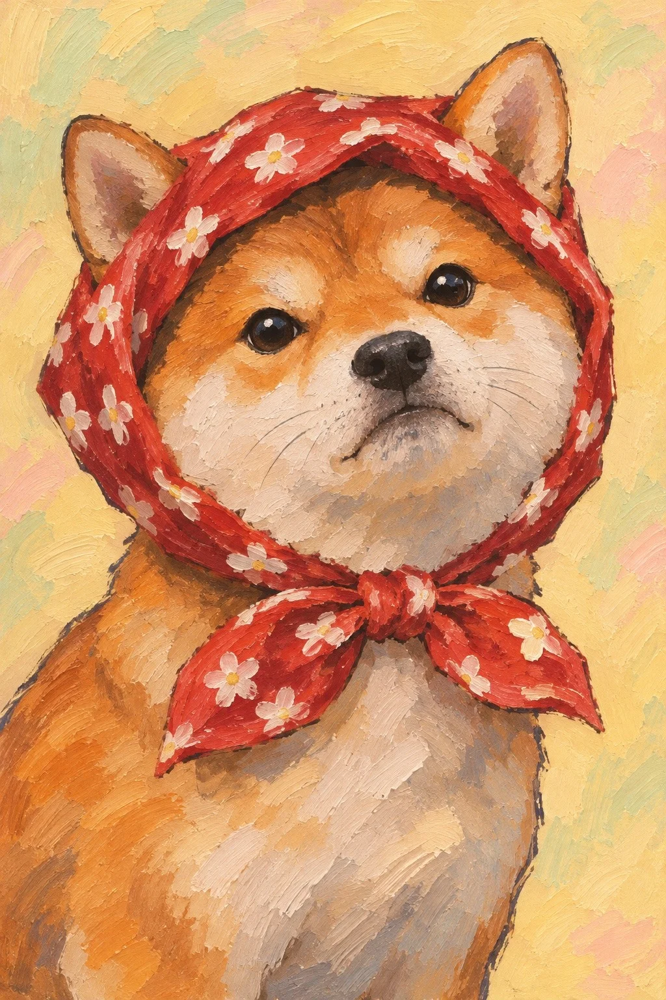

# Gouache Animal Portrait: Shiba in a Tomato-Red Floral Headscarf (2:3)

**中文标题：** 水粉厚涂小动物：番茄红碎花头巾柴犬（2:3）  
**ID:** `gi25-x-1584` · **Mode:** `generate`  
**Categories:** `general`  
**Tags:** `x-twitter`, `community`, `gpt-image-2.5`, `x-direct`, `zh`



### Gouache Animal Portrait: Shiba in a Tomato-Red Floral Headscarf (2:3)

```text
Create an image with the following visual system. Replace the subject as specified.

Visual system (light, color, composition, medium, mood):
【画面风格】一张竖幅约 2:3 的水粉厚涂肖像插画，像用平头笔在纸板上一层层堆出来，笔触短而粗、方向清楚，颜料边缘带干刷的毛边。一只动物半身正面入画，身体偏左下，头部在画面中上方，略微歪头，眼睛直直看着观者，表情有点倔、有点无辜。头上包着一条头巾或戴着一顶帽子，耳朵从里面露出来；头巾在下巴下面松松地打一个结，两片结角往外翻，布料上有手绘的简单花纹，用几笔白色和浅色笔触点出褶皱高光。背景是大片奶黄色，夹着淡薄荷绿和一点淡粉的擦笔，不画任何具体环境。光从左前方来，柔和均匀，脸上有微弱的暖色受光，身体暗部用深蓝灰和赭石的笔触压出体积，轮廓外缘有一道细细的深色勾边。色彩：奶黄背景占大面积，动物毛色和头巾是画面里的两块主色，头巾的饱和度最高，眼睛是一处亮色点睛。整体像一张小尺寸的架上画，安静，带一点幽默。不要 3D，不要光滑的数码笔刷，不要照片质感，不要文字、签名和水印。

New subject:
【主体】一只柴犬，橘黄色短毛，白色的嘴套和胸口，黑色小圆眼睛很亮。头上包一条番茄红底、白色小碎花的头巾，结打在下巴下面。
```

- **Recommended model:** `gpt-image-2.5-flare`
- **Settings:** _(defaults)_
- **Source:** [community](https://x.com/static_stare/status/2122914550349770892) — @static_stare
- **License note:** Original public X post; quoted with attribution — remix with attribution
- **Notes:** Collected directly from X; original post https://x.com/static_stare/status/2122914550349770892; post text names GPT Image 2.5; discovered via X search, prompt re-verified against the original X post via api.fxtwitter.com; verified=True; visual-system + replaceable-subject template; prompt for image 1 of 4 (the author offers the other three on request); post names GPT Image 2.5 without a Flare/Sunburst variant; preview is image 1
- **Preview:** `previews/gi25-x-1584.webp`
