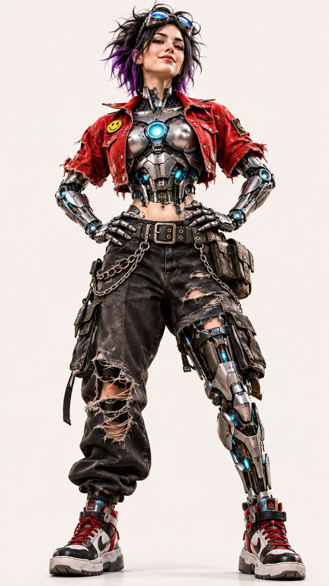

# Photoreal Cyberpunk Cyborg Warrior Portrait (9:16)

**中文标题：** 赛博朋克机械武士全身肖像（9:16）  
**ID:** `gi25-x-1585` · **Mode:** `generate`  
**Categories:** `general`  
**Tags:** `x-twitter`, `community`, `gpt-image-2.5`, `x-direct`, `en`



### Photoreal Cyberpunk Cyborg Warrior Portrait (9:16)

```text
{
  "prompt": "A full-body portrait of a young female cyberpunk warrior, approximately 22 years old, standing confidently in a powerful hands-on-hips pose. She has a rebellious personality, sharp facial features, a confident mischievous smirk, expressive eyes and messy spiky black hair with vibrant purple streaks. Futuristic reflective goggles rest on her head. Her body is a unique human-cyborg hybrid, with heavily detailed exposed mechanical anatomy and battle-worn metallic armor replacing parts of her natural body. Her entire arms are robotic, made of scratched silver steel plates, visible pistons, mechanical joints, cables and glowing cyan energy elements. Her torso features layered silver mechanical armor with a bright circular cyan energy reactor embedded in the chest. Her neck and waist have visible futuristic mechanical components. One leg has exposed robotic sections with intricate machinery and metallic plating, while the other has a partially armored appearance. She wears a cropped distressed red denim jacket with torn edges, small patches and a yellow smiley badge, oversized ripped charcoal cargo pants, a heavy utility belt with pouches and hanging chains, and chunky futuristic red, black and white combat sneakers. Add small industrial accessories and subtle glowing blue lights throughout her mechanical body. The character should look like an original young superhero warrior from a futuristic sci-fi universe, rebellious, fearless, edgy and visually unforgettable. A distinctive combination of realistic human skin, rugged steel machinery and street fashion. Clean plain off-white studio background, no environment, no scenery, no props. Full body completely visible from head to shoes, centered composition, slightly low camera angle, dramatic yet soft professional studio lighting, ultra-detailed 3D character design, photorealistic textures, premium AAA video game character concept art, sharp focus, vertical 9:16 composition.",
  "negative_prompt": "Old woman, middle-aged woman, childish appearance, ordinary human body, fully human arms, fully human legs, generic superhero costume, traditional spandex suit, excessive armor covering the entire body, cartoon, anime, flat illustration, low-quality CGI, plastic skin, blurry details, extra limbs, extra fingers, missing fingers, distorted anatomy, cropped feet, cropped head, busy background, cityscape, weapons, text, watermark, logo.",
  "aspect_ratio": "9:16",
  "camera": {
    "shot": "Full body portrait",
    "angle": "Slightly low angle",
    "composition": "Centered character",
    "lighting": "Soft dramatic studio lighting"
  },
  "style": "Photorealistic futuristic cyberpunk character design, AAA video game concept art",
  "background": "Clean minimal off-white studio background"
}
```

- **Recommended model:** `gpt-image-2.5-flare`
- **Settings:** _(defaults)_
- **Source:** [community](https://x.com/Just_Anika_Here/status/2122917779234005426) — @Just_Anika_Here
- **License note:** Original public X post; quoted with attribution — remix with attribution
- **Notes:** Collected directly from X; original post https://x.com/Just_Anika_Here/status/2122917779234005426; post text names GPT Image 2.5; discovered via X search, prompt re-verified against the original X post via api.fxtwitter.com; verified=True; post names GPT Image 2.5 without a variant; the published prompt is a JSON object with prompt, negative_prompt, aspect_ratio, camera, style and background; preview is image 1 of 2
- **Preview:** `previews/gi25-x-1585.webp`
