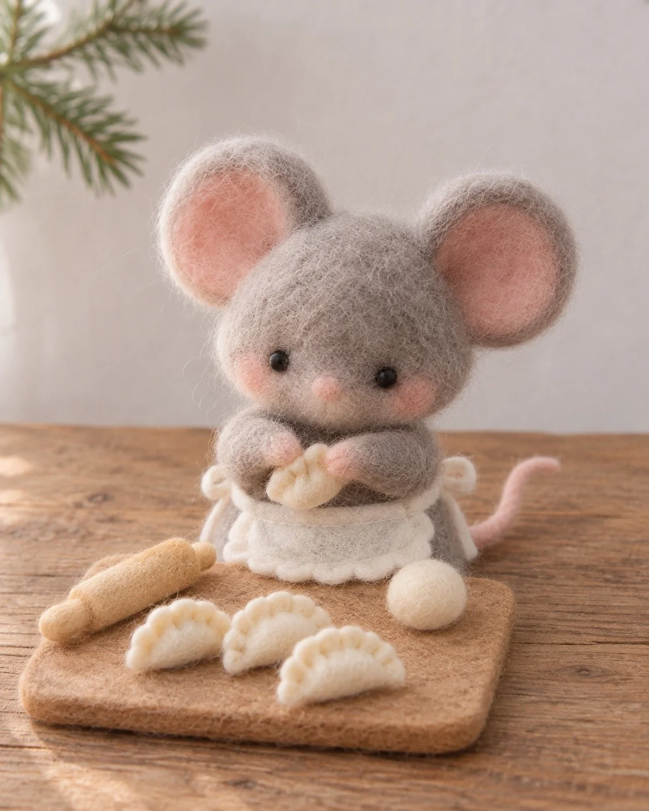

# Felted Wool Mouse Making Dumplings on a Wooden Table (4:5)

**中文标题：** 羊毛毡小老鼠在木桌上包饺子（4:5）  
**ID:** `gi25-x-1586` · **Mode:** `generate`  
**Categories:** `general`  
**Tags:** `x-twitter`, `community`, `gpt-image-2.5`, `x-direct`, `zh`



### Felted Wool Mouse Making Dumplings on a Wooden Table (4:5)

```text
Create an image with the following visual system. Replace the subject as specified.

Visual system (light, color, composition, medium, mood):
【画面风格】一张竖幅约 4:5 的手作实拍照片，主角是一只羊毛毡戳出来的小动物，正在一张浅色原木桌面上专心做一件小事。机位比桌面略高一点，中景，主角在画面中下部居中，桌面占下半幅，木纹清楚、有点旧；后面是一面浅灰白的墙，墙和桌面之间有一条清楚的分界线。左上角从画外伸进来一小枝绿色松枝，略微虚焦。光线是窗边来的柔和自然光，从左侧照过来，羊毛表面能看到细细的毛糙纤维和一圈绒毛光晕，摆件底下有浅浅的软阴影。小动物身体圆滚，头大身小，黑色小珠子眼睛，鼻子和脸颊带一点淡粉；它手边的道具和食物也全是羊毛毡做的，尺寸和它相配，表面同样是蓬松的羊毛质感。色彩：原木暖棕和浅灰白墙打底，角色和道具只用两三种柔和的饱和色，整体温暖、干净，像手作人工作台上的一个日常小场景。画面里不要任何文字、水印、logo 和签名，不要圣诞帽、鹿角、圣诞树这类节日装扮，不要挂绳和钥匙扣，只有一个角色。

New subject:
【主体】一只灰色的小老鼠，大圆耳朵内侧是粉色，系一条小小的白围裙，坐在一块羊毛毡小面板前包饺子。面前摆着三四个已经包好的白色小饺子和一小团面团，旁边放一根浅木色的羊毛毡小擀面杖。
```

- **Recommended model:** `gpt-image-2.5-flare`
- **Settings:** _(defaults)_
- **Source:** [community](https://x.com/static_stare/status/2122958117025775989) — @static_stare
- **License note:** Original public X post; quoted with attribution — remix with attribution
- **Notes:** Collected directly from X; original post https://x.com/static_stare/status/2122958117025775989; post text names GPT Image 2.5; discovered via X search, prompt re-verified against the original X post via api.fxtwitter.com; verified=True; visual-system + replaceable-subject template; prompt for image 1 of 4 (the author offers the other three on request); post names GPT Image 2.5 without a Flare/Sunburst variant; preview is image 1
- **Preview:** `previews/gi25-x-1586.webp`
