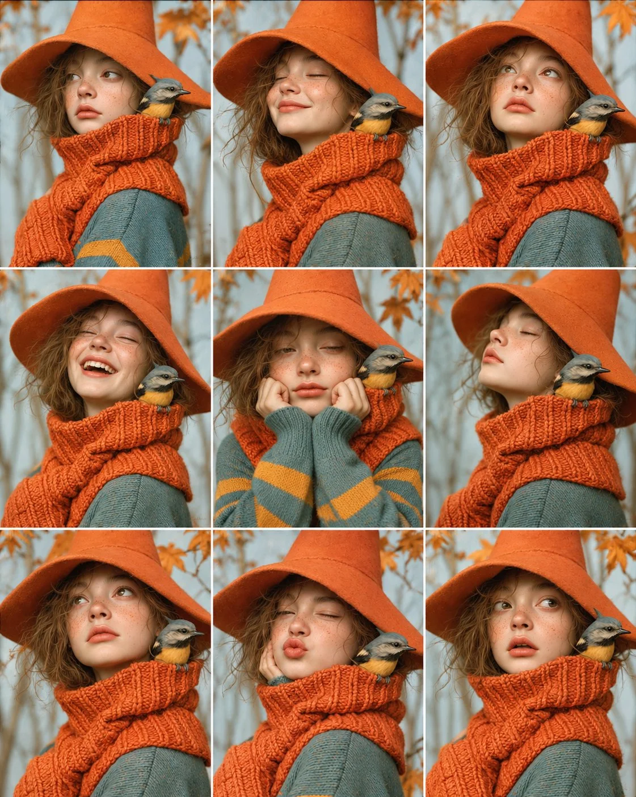

# 3×3 Fine-Art Portrait Collage with Pale Flowers (3:4)

**中文标题：** 九宫格淡色花卉艺术肖像拼贴（3:4）  
**ID:** `gi25-x-1590` · **Mode:** `generate`  
**Categories:** `general`  
**Tags:** `x-twitter`, `community`, `gpt-image-2.5`, `x-direct`, `en`



### 3×3 Fine-Art Portrait Collage with Pale Flowers (3:4)

```text
Create a cinematic 3×3 collage of nine artistic fine-art portraits of a beautiful young woman surrounded by delicate white and pale pink flowers. The entire composition should feel dreamy, surreal, poetic, and ethereal, like an experimental fashion editorial photographed on vintage film.

Subject: A young woman with delicate natural facial features, fair skin, and dark brown hair. She wears simple minimalist clothing in muted ivory, beige, and soft gray tones. Her expressions are peaceful, emotional, and introspective.

Flower interaction: Large delicate cosmos and daisy-like flowers with soft white and blush-pink petals overlap her face, eyes, cheeks, and hair. Some flowers appear translucent, blending naturally with her facial features through artistic double exposure.

Nine-panel composition:

1. Side-profile portrait with a large white flower covering the eyes, soft motion blur, and dark muted green background.
2. Elegant black side-profile silhouette with flowers growing around the head and face, against a pale sage-green background.
3. Dreamy close-up portrait with flowers overlapping the eyes and forehead, subtle ghosting and soft focus.
4. Front-facing portrait with oversized pale pink flowers partially covering the eyes and face.
5. Close-up portrait with closed eyes, a flower floating across one cheek, and a secondary translucent side-profile silhouette.
6. Front-facing portrait with closed eyes and a flower moving horizontally across the face, creating a beautiful motion trail.
7. Dark female silhouette in side profile with delicate flowers blended into the hair against a muted green background.
8. Intimate close-up with multiple white flowers layered across the eyes and lower face, creating a surreal floral double exposure.
9. Side-profile portrait with a large pale pink flower covering the face, layered facial exposures, and dreamy motion blur.

Photography style: Artistic double exposure, intentional slow-shutter motion blur, translucent overlays, ghosting, soft-focus portrait photography, vintage analog film texture, subtle film grain, and fine-art editorial photography.

Color palette: Muted sage green, dusty teal, pale mint, warm ivory, soft cream, blush pink, and natural skin tones.

Lighting: Soft diffused natural light, gentle shadows, hazy highlights, atmospheric depth, slightly faded film colors, and low-contrast cinematic grading.

Layout: Perfect 3×3 grid with nine equally sized rectangular portrait panels, aligned seamlessly with subtle panel divisions. Maintain a consistent artistic aesthetic across all nine images.

Quality: Photorealistic, highly detailed facial features, natural skin texture, delicate flower petals, cinematic composition, professional editorial photography.

Aspect ratio: 3:4 vertical.

No text, no typography, no logos, no watermarks, no captions, no decorative lettering.
```

- **Recommended model:** `gpt-image-2.5-flare`
- **Settings:** _(defaults)_
- **Source:** [community](https://x.com/harboriis/status/2123012000233988333) — @harboriis
- **License note:** Original public X post; quoted with attribution — remix with attribution
- **Notes:** Collected directly from X; original post https://x.com/harboriis/status/2123012000233988333; post text names GPT Image 2.5; discovered via X search, prompt re-verified against the original X post via api.fxtwitter.com; verified=True; post names GPT Image 2.5 without a Flare/Sunburst variant; preview is the published collage
- **Preview:** `previews/gi25-x-1590.webp`
