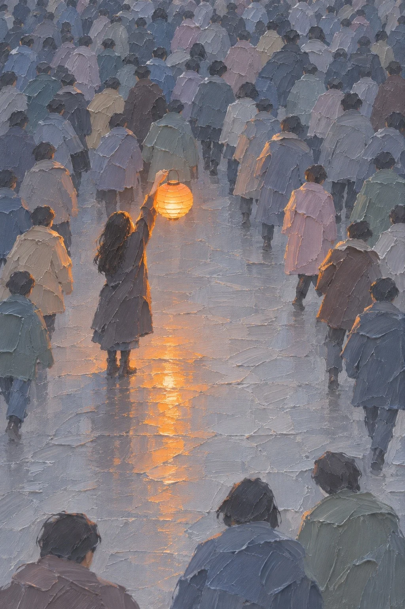

# Impasto Oil Painting: Girl Raising a Paper Lantern (2:3)

**中文标题：** 厚涂油画：高举纸灯笼的女孩（2:3）  
**ID:** `gi25-x-1592` · **Mode:** `generate`  
**Categories:** `general`  
**Tags:** `x-twitter`, `community`, `gpt-image-2.5`, `x-direct`, `zh`



### Impasto Oil Painting: Girl Raising a Paper Lantern (2:3)

```text
Create an image with the following visual system. Replace the subject as specified.

Visual system (light, color, composition, medium, mood):
【画面风格】一张竖幅约 2:3 的油画刀厚涂油画，颜料堆得很厚，每一刀都留下平整的刀面和翘起的边缘，看得出画布上一层层的颜料。高机位往下俯看一片开阔的灰白广场，画面上半部分挤满密密的人群，全是背影或侧背影，每个人用几刀色块概括，没有五官和细节，衣服是灰蓝、青绿、雾粉、土黄、深棕这些低饱和的冷色和中性色。画面中下部人群稍微散开，留出一片空地，主体站在空地偏左的位置，是整张画里唯一的暖色光源：橙黄色的光从主体手里的东西散开，在周围人的肩膀和后背上染出一圈暖色边光，并在微湿反光的灰白地面上拖出一道长长的橙色倒影。其余地方都是阴天一样的冷灰蓝漫射光，没有第二处暖色。画面最下沿有两三个离得更近的小人背影，被画框裁掉一半，拉出纵深。色彩：冷灰蓝青占九成，橙黄只出现在主体的光源和它照到的地方，冷暖对比非常集中。氛围安静，有点孤独，但很温柔，像在人群里一眼认出一个熟人。不要火焰、烟雾、爆炸、事故或任何危险感，不要文字、签名和水印。

New subject:
【主体】一个穿深灰大衣的女孩，高高举着一盏发橙光的圆形纸灯笼，光把她的头顶和身边几个人照暖了。
```

- **Recommended model:** `gpt-image-2.5-flare`
- **Settings:** _(defaults)_
- **Source:** [community](https://x.com/static_stare/status/2123049532145414228) — @static_stare
- **License note:** Original public X post; quoted with attribution — remix with attribution
- **Notes:** Collected directly from X; original post https://x.com/static_stare/status/2123049532145414228; post text names GPT Image 2.5; discovered via X search, prompt re-verified against the original X post via api.fxtwitter.com; verified=True; visual-system + replaceable-subject template; prompt for image 1 of 4 (the author offers the other three on request); post names GPT Image 2.5 without a Flare/Sunburst variant; preview is image 1
- **Preview:** `previews/gi25-x-1592.webp`
