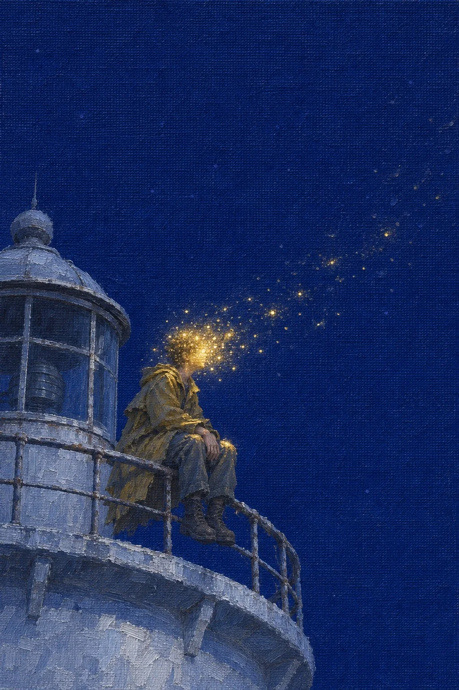

# Canvas Oil Painting: Youth on a Lighthouse with Fireflies (2:3)

**中文标题：** 布面油画：灯塔顶被萤火虫光点包围的人（2:3）  
**ID:** `gi25-x-1593` · **Mode:** `generate`  
**Categories:** `general`  
**Tags:** `x-twitter`, `community`, `gpt-image-2.5`, `x-direct`, `zh`



### Canvas Oil Painting: Youth on a Lighthouse with Fireflies (2:3)

```text
Create an image with the following visual system. Replace the subject as specified.

Visual system (light, color, composition, medium, mood):
【画面风格】一张竖幅约 2:3 的布面油画，画布的粗麻纹理清楚地从颜料底下透出来，笔触是细碎的短线厚涂，像被画布纹理切过一样。整片天空是均匀的深钴蓝夜色，几乎没有渐变，大面积留空，只有极少的淡蓝紫细点。低机位从下往上看，画面下三分之一是一处高处的上沿，用一条斜线切进画面，表面被月光照成冷白和灰蓝。主体安静地坐在这个高处的边缘，双手放在膝上，身体微微前倾，画得写实，笔触松。主体头部的位置被一团柔和发光的东西包住，看不到五官，这团光是整张画里唯一的暖色和最亮的地方，向画面右上方轻轻飘散，散出的光点和细碎颜料慢慢融进深蓝夜空。光只照亮主体的肩膀和膝盖，在衣服上留下一点暖色反光。色彩：深钴蓝夜空占七成以上，高处是冷白和灰蓝，主体衣服是暗橄榄或深灰这类暗色，头部的光是唯一的亮色。氛围安静、出神，像在发呆，带一点梦感，不恐怖，不要火焰和烟，不要文字、签名和水印。

New subject:
【主体】一个穿旧黄色雨衣的年轻人，坐在一座白色灯塔顶层的铁栏杆外沿，灯塔的灯没有亮，他的头被一团慢慢飞散的暖黄色萤火虫光点包住。
```

- **Recommended model:** `gpt-image-2.5-flare`
- **Settings:** _(defaults)_
- **Source:** [community](https://x.com/static_stare/status/2123054866503471107) — @static_stare
- **License note:** Original public X post; quoted with attribution — remix with attribution
- **Notes:** Collected directly from X; original post https://x.com/static_stare/status/2123054866503471107; post text names GPT Image 2.5; discovered via X search, prompt re-verified against the original X post via api.fxtwitter.com; verified=True; visual-system + replaceable-subject template; prompt for image 1 of 4 (the author offers the other three on request); post names GPT Image 2.5 without a Flare/Sunburst variant; preview is image 1
- **Preview:** `previews/gi25-x-1593.webp`
