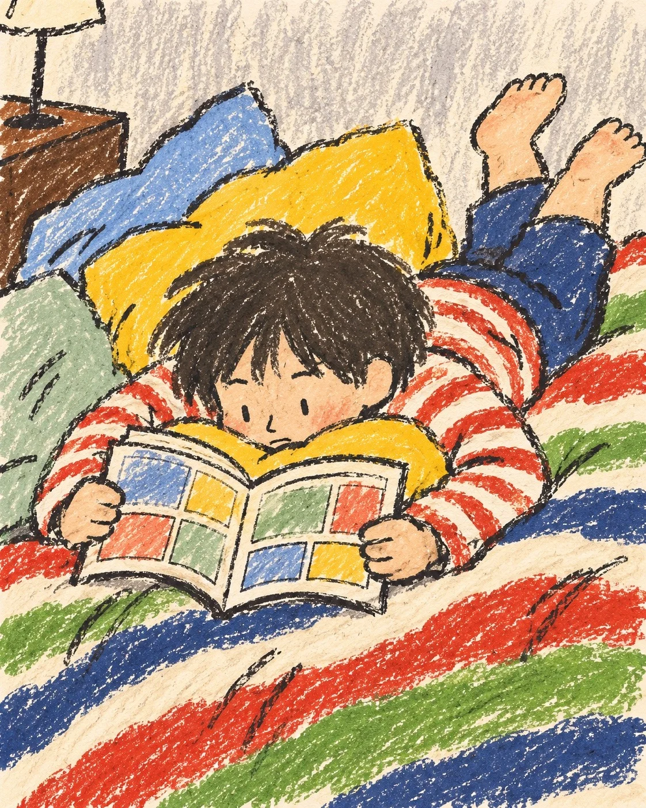

# Oil-Pastel Illustration: Child Reading Comics on a Striped Quilt (4:5)

**中文标题：** 油画棒插画：趴在条纹被上看漫画的小孩（4:5）  
**ID:** `gi25-x-1598` · **Mode:** `generate`  
**Categories:** `general`  
**Tags:** `x-twitter`, `community`, `gpt-image-2.5`, `x-direct`, `zh`



### Oil-Pastel Illustration: Child Reading Comics on a Striped Quilt (4:5)

```text
Create an image with the following visual system. Replace the subject as specified.

Visual system (light, color, composition, medium, mood):
【画面风格】一张竖幅约 4:5 的油画棒和蜡笔手绘插画，粗糙的蜡质笔触大块涂抹：每块颜色都是用油画棒侧面横着、斜着宽宽地抹开的，一块一块平涂，笔触宽、方向乱，颜色涂不满、露出纸底的颗粒白点，不是细密的排线，也不是彩铅；轮廓用随手的黑色粗细不一的蜡笔线勾出来，线条松、会断、有点歪，阴影用几道黑色或深色的斜排线草草带过。近景，机位略高，斜着构图：一张床或沙发的一角从画面左下斜伸到右上，铺着一条宽条纹的被子或毯子，条纹是番茄红、草绿、深蓝和奶白相间，被子的褶皱用黑色短线画出；后面堆着几个大靠垫，一个明黄、一个天蓝、一个薄荷灰绿。背景是一面奶白偏灰的墙，用灰色蜡笔竖着轻轻扫过，左上角露出一角深棕色的木头床头柜和一根细细的黑色台灯杆。光是午后从右边来的柔和散光，没有强烈阴影。色彩：黄、蓝、红、绿四种饱和色块撞在一起，奶白和灰把它们隔开，黑线压住整体。人和动物的脸画得很简单，几笔黑线带过眼睛和嘴，不要动漫大眼睛，不要可爱 Q 版比例。整体松弛、慵懒、有点童趣，像午后懒得动。不要 3D，不要光滑数码笔刷，不要照片质感，不要文字、签名和水印。

New subject:
【主体】一个短头发的小孩，穿红白条纹长袖，趴在条纹被子上，下巴垫在靠垫边，两只手捧着一本摊开的漫画书看得入神，光着两只脚翘在后面。漫画书页只画色块和格子，没有任何可读文字。
```

- **Recommended model:** `gpt-image-2.5-flare`
- **Settings:** _(defaults)_
- **Source:** [community](https://x.com/static_stare/status/2123320916331618682) — @static_stare
- **License note:** Original public X post; quoted with attribution — remix with attribution
- **Notes:** Collected directly from X; original post https://x.com/static_stare/status/2123320916331618682; post text names GPT Image 2.5; discovered via X search, prompt re-verified against the original X post via api.fxtwitter.com; verified=True; visual-system + replaceable-subject template; prompt for image 1 of 4 (the author offers the other three on request); post names GPT Image 2.5 without a Flare/Sunburst variant; preview is image 1
- **Preview:** `previews/gi25-x-1598.webp`
