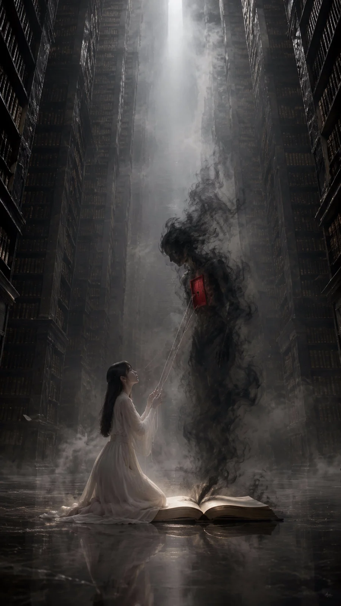

# Dark Surreal Archive: Kneeling Figure and a Smoke Self with a Crimson Door (9:16)

**中文标题：** 心理超现实：地下书库中与胸前有红门的黑烟人形对坐的白衣人（9:16）  
**ID:** `gi25-x-1599` · **Mode:** `generate`  
**Categories:** `general`  
**Tags:** `x-twitter`, `community`, `gpt-image-2.5`, `x-direct`, `en`



### Dark Surreal Archive: Kneeling Figure and a Smoke Self with a Crimson Door (9:16)

```text
Use case: stylized-concept
Asset type: vertical social-media artwork for the “Your Dark Side” theme
Create an original psychological dark-surrealist scene in a colossal underground archive. Endless shelves of sealed black books rise like skyscrapers and vanish into fog. In the central aisle, a solitary human figure in bone-white clothing kneels before one open book on the floor. No words are visible. From the blank pages rises a delicate life-size figure made entirely of dense black smoke, standing face-to-face with the kneeling person. The smoke figure has no eyes or mouth; instead, its chest contains a small locked crimson door. Thin threads connect that door to the kneeling person’s hands, suggesting a secret self finally acknowledged.
Vertical 9:16 framing, towering shelves create a narrow symmetrical canyon, high-angle shaft of cold silver light, the two figures positioned small in the lower center, immense oppressive scale above them. Black paper, aged stone, floating ash, volumetric fog, subtle polished-floor reflections, premium photorealistic dark concept art, refined editorial composition, quiet dread and introspection rather than horror spectacle.
Color palette: obsidian black, graphite, bone white, cold silver, a single muted crimson accent at the tiny door.
Constraints: entirely original metaphor; blank book pages with absolutely no writing; no recognizable person; no text, symbols, logos, signatures, borders, or watermark.
Avoid: visible letters or runes, portrait close-up, split face, black substance on skin, glowing eyes, gore, skulls, conventional ghosts, fantasy wizard styling, imitation of any named artist.
```

- **Recommended model:** `gpt-image-2.5-flare`
- **Settings:** _(defaults)_
- **Source:** [community](https://x.com/ZDuo_MoreAi/status/2123325655828087087) — @ZDuo_MoreAi
- **License note:** Original public X post; quoted with attribution — remix with attribution
- **Notes:** Collected directly from X; original post https://x.com/ZDuo_MoreAi/status/2123325655828087087; post text names GPT Image 2.5; discovered via X search, prompt re-verified against the original X post via api.fxtwitter.com; verified=True; post names GPT Image 2.5 without a Flare/Sunburst variant; prompt follows 'Prompt below'
- **Preview:** `previews/gi25-x-1599.webp`
