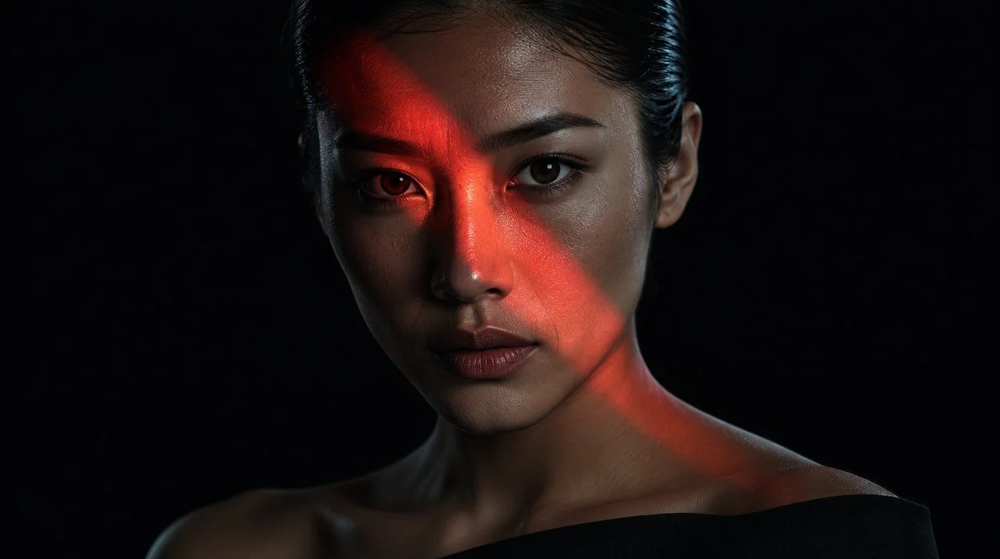

# Editorial Portrait Lit by a Diagonal Blade of Crimson Light (4:5)

**中文标题：** 编辑风肖像：一道斜切的猩红光（4:5）  
**ID:** `gi25-x-1602` · **Mode:** `generate`  
**Categories:** `general`  
**Tags:** `x-twitter`, `community`, `gpt-image-2.5`, `x-direct`, `en`



### Editorial Portrait Lit by a Diagonal Blade of Crimson Light (4:5)

```text
Create an extraordinary photorealistic cinematic editorial portrait, vertical 4:5, full bleed, no text.
An adult East Asian woman with slicked-back black hair, a strong facial structure and a calm, uncompromising expression. Tight portrait from collarbones to just above the head. Her face is almost frontal, rotated a few degrees toward camera left, eyes looking directly into the lens. Bare shoulders above a simple matte-black architectural neckline.

A precisely controlled diagonal blade of saturated crimson light crosses one eye, the bridge of the nose and the opposite cheek. Produce this effect with a hard optical spotlight and a narrow slit gobo. The band must follow the actual facial geometry: changing width across the nose, breaking into shadow where the face occludes it, never resembling a flat red stripe painted onto the image.

An extremely restrained cool-white soft source reveals the unlit eye and the natural color of the shadow-side skin, approximately three stops below the red accent. The surrounding face falls into rich near-black tones. A faint neutral edge separates one shoulder from the background without tracing the entire silhouette.

85mm portrait lens at eye level. The red diagonal is the dominant graphic gesture. Both eyes remain within the plane of sharp focus. Deep black background with generous darkness above one shoulder. No additional props.

Visible pores, fine facial hair, subtle moisture along the lower eyelid, natural lips and realistic hairline. Preserve texture inside the red illumination; do not clip the red channel into a featureless patch.

Intense but disciplined color, deep dimensional shadows, subtle cinematic grain, elegant highlight roll-off. A luxury editorial portrait with psychological tension. No neon tubes in frame, no digital face paint, no plastic skin, no decorative smoke.
```

- **Recommended model:** `gpt-image-2.5-flare`
- **Settings:** _(defaults)_
- **Source:** [community](https://x.com/CharaspowerAI/status/2123385804604985551) — @CharaspowerAI
- **License note:** Original public X post; quoted with attribution — remix with attribution
- **Notes:** Collected directly from X; original post https://x.com/CharaspowerAI/status/2123385804604985551; post text names GPT Image 2.5; discovered via X search, prompt re-verified against the original X post via api.fxtwitter.com; verified=True; post names GPT Image 2.5 without a Flare/Sunburst variant
- **Preview:** `previews/gi25-x-1602.webp`
