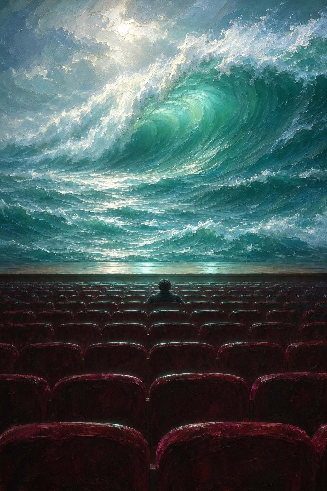

# Cinematic Oil Painting: A Lone Viewer Before a Wave on Stage (2:3)

**中文标题：** 厚涂油画：空荡剧场里看着舞台海浪的独自观众（2:3）  
**ID:** `gi25-x-1603` · **Mode:** `generate`  
**Categories:** `general`  
**Tags:** `x-twitter`, `community`, `gpt-image-2.5`, `x-direct`, `zh`



### Cinematic Oil Painting: A Lone Viewer Before a Wave on Stage (2:3)

```text
Create an image with the following visual system. Replace the subject as specified.

Visual system (light, color, composition, medium, mood):
【画面风格】一张竖幅约 2:3 的电影感超现实油画，厚涂笔触明显，颜料一层层堆出肌理，暗部有细碎的干刷。机位在剧场观众席后排、略高于座椅，正对舞台，严格对称构图：画面上半部到中部是一整面巨大的舞台，台口没有幕布边框，舞台上不是布景，而是一整片真实的宏大景象，像把整个世界搬上了舞台，景象的光是整张画的主光源。舞台前沿是一道细长的木质台口边，被舞台的光照亮。画面下半部是一排排丝绒剧场座椅，从近处一直排到舞台前，椅背顶端被舞台光勾出一道亮边，其余沉在暗里。整个剧场空荡荡，只有一个观众坐在中间偏前的一排正中，只看到背影，深色衣服，一动不动地看着舞台，人很小，被舞台的景象衬得更小。舞台之外的剧场空间全部沉在暗色里，看不到墙和灯。色彩：舞台景象的颜色占据上半幅并照亮座椅，座椅是深红丝绒，暗部偏深棕黑。氛围安静、宏大、温柔，像一个人包场看一场只演给他的戏。不要火焰、烟雾、爆炸、灾难和任何危险感，不要文字、签名和水印。

New subject:
【主体】舞台上是一整面翻涌的大海，一道巨大的青绿色海浪正慢慢卷起，浪顶是白色的泡沫，浪后面透出银白的天光，水光把台口和前几排座椅照成冷青色，座椅的红丝绒在冷光里显得更深。
```

- **Recommended model:** `gpt-image-2.5-flare`
- **Settings:** _(defaults)_
- **Source:** [community](https://x.com/static_stare/status/2123389095246541121) — @static_stare
- **License note:** Original public X post; quoted with attribution — remix with attribution
- **Notes:** Collected directly from X; original post https://x.com/static_stare/status/2123389095246541121; post text names GPT Image 2.5; discovered via X search, prompt re-verified against the original X post via api.fxtwitter.com; verified=True; visual-system + replaceable-subject template; prompt for image 1 of 4 (the author offers the other three on request); post names GPT Image 2.5 without a Flare/Sunburst variant; preview is image 1
- **Preview:** `previews/gi25-x-1603.webp`
