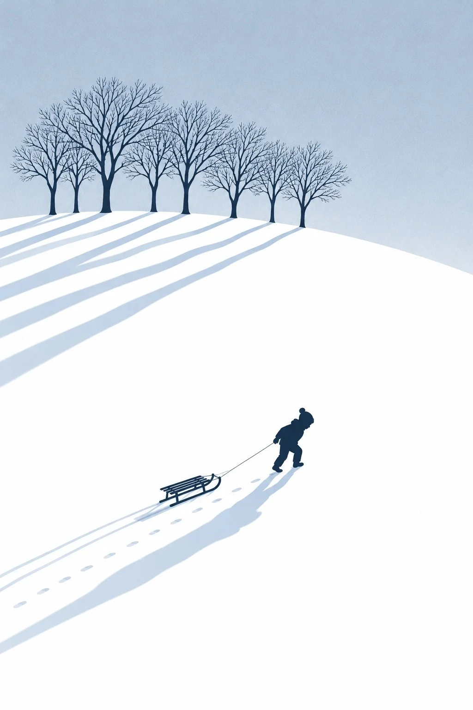

# Minimal Screenprint: Child Pulling an Empty Sled up a Snow Slope (2:3)

**中文标题：** 极简版画：雪坡上拉空雪橇的小孩（2:3）  
**ID:** `gi25-x-1605` · **Mode:** `generate`  
**Categories:** `general`  
**Tags:** `x-twitter`, `community`, `gpt-image-2.5`, `x-direct`, `zh`



### Minimal Screenprint: Child Pulling an Empty Sled up a Snow Slope (2:3)

```text
Create an image with the following visual system. Replace the subject as specified.

Visual system (light, color, composition, medium, mood):
【画面风格】一张竖幅约 2:3 的极简丝网版画风插画，平涂色块，边缘干净利落，没有笔触和渐变，只在天空用很细微的颗粒做一点过渡。画面下三分之二是一整面圆润的纯白雪坡，坡线从左往右弧形隆起，坡顶在画面中上方偏左。坡顶站着一排七八棵光秃秃的冬树，枝杈细密，全是一个颜色的深墨蓝剪影。天空是很淡的灰蓝色，靠近坡线处略亮，这是月光下的夜晚，天上没有月亮也没有星星。月光从画面右后方低低地照过来，坡顶那排树在雪地上拖出一道道又长又斜的淡蓝色影子，从坡顶往左下方一直伸到画面边缘，像几条平行的蓝色缎带。雪坡中间偏下有一个很小的深墨蓝剪影主体，它身后的雪地上留着一串浅浅的小脚印，脚下也拖着一道被拉长的淡蓝色影子，影子比它本身大得多。色彩只有三种：纯白雪地、淡灰蓝天空和影子、深墨蓝剪影。大面积留白，安静、冷、干净，像深夜一个人在雪地里走。不要文字、签名和水印，画面里只出现一个小主体。

New subject:
【主体】一个戴毛线帽的小孩，弯着腰，手里拽着一根绳子，往坡上拉一只空的木头小雪橇，雪橇在身后划出两道浅浅的痕。
```

- **Recommended model:** `gpt-image-2.5-flare`
- **Settings:** _(defaults)_
- **Source:** [community](https://x.com/static_stare/status/2123419405468242196) — @static_stare
- **License note:** Original public X post; quoted with attribution — remix with attribution
- **Notes:** Collected directly from X; original post https://x.com/static_stare/status/2123419405468242196; post text names GPT Image 2.5; discovered via X search, prompt re-verified against the original X post via api.fxtwitter.com; verified=True; visual-system + replaceable-subject template; prompt for image 1 of 4 (the author offers the other three on request); post names GPT Image 2.5 without a Flare/Sunburst variant; preview is image 1
- **Preview:** `previews/gi25-x-1605.webp`
