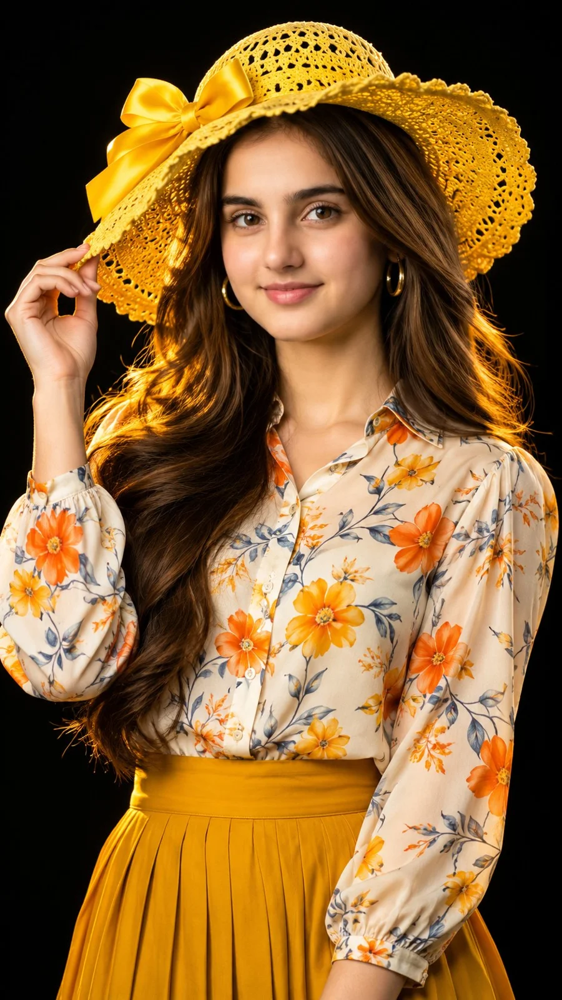

# Fashion Editorial: Woman in a Golden-Yellow Crocheted Sun Hat

**中文标题：** 时尚大片：金色钩针太阳帽与花卉上衣  
**ID:** `gi25-x-1606` · **Mode:** `generate`  
**Categories:** `general`  
**Tags:** `x-twitter`, `community`, `gpt-image-2.5`, `x-direct`, `en`



### Fashion Editorial: Woman in a Golden-Yellow Crocheted Sun Hat

```text
Create an ultra-realistic, high-end fashion editorial portrait of a beautiful young woman with long, thick, naturally wavy dark brown hair, wearing a gorgeous golden-yellow crocheted sun hat decorated with a large silky yellow bow on the left side.

She is wearing elegant golden hoop earrings and a beautiful cream-colored floral blouse featuring vibrant orange and yellow flowers with delicate blue-grey leaves, paired with a high-waisted mustard-yellow pleated skirt.

Pose: The woman gently holds the brim of her sun hat with one hand, looking directly into the camera with a warm, charming, confident smile. Her expression is natural, graceful, and captivating.

Hair: Long, voluminous, glossy dark brown hair cascading over her shoulders in beautiful soft waves.

Makeup: Soft natural glam makeup, flawless glowing skin, subtle rosy blush, naturally defined eyebrows, warm brown eyes, and soft pink glossy lips.

Background: Pure deep black studio background with dramatic yet soft golden rim lighting illuminating her hair and outfit.

Lighting: Professional studio portrait photography, soft frontal beauty lighting, cinematic golden highlights, realistic skin texture, balanced shadows, beautiful catchlights in the eyes.

Composition: Vertical 9:16 portrait, waist-up to three-quarter body framing, centered subject, elegant fashion photography composition.

Style: Photorealistic, luxury fashion magazine editorial, 85mm portrait lens, shallow depth of field, ultra-detailed fabric textures, realistic hair strands, natural skin pores, HDR, 8K resolution.

Important: Maintain anatomically correct hands, realistic facial proportions, natural fingers, detailed floral patterns, and premium professional photography quality.
```

- **Recommended model:** `gpt-image-2.5-flare`
- **Settings:** _(defaults)_
- **Source:** [community](https://x.com/Arina_hoqe/status/2123450760482766899) — @Arina_hoqe
- **License note:** Original public X post; quoted with attribution — remix with attribution
- **Notes:** Collected directly from X; prompt posted as the author's own reply https://x.com/Arina_hoqe/status/2123450760482766899 to https://x.com/Arina_hoqe/status/2123450756229742623, which carries the images; GPT Image 2.5 is named in the parent post; discovered via X search, prompt re-verified against the original X post via api.fxtwitter.com; verified=True; prompt posted as the author's self-reply; the parent hook mentions a 'miniature world' template, but the published prompt is a fashion editorial portrait; post names GPT Image 2.5 without a Flare/Sunburst variant
- **Preview:** `previews/gi25-x-1606.webp`
