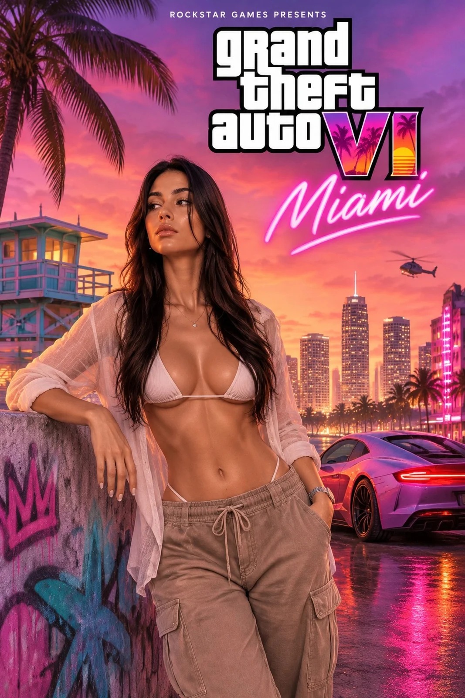

# GTA VI Key-Art Poster: Woman Against a Graffiti Wall at Miami Sunset

**中文标题：** GTA VI 主视觉海报：迈阿密日落涂鸦墙边的女性  
**ID:** `gi25-x-1607` · **Mode:** `generate`  
**Categories:** `general`, `poster-typography`  
**Tags:** `x-twitter`, `community`, `gpt-image-2.5`, `x-direct`, `en`



### GTA VI Key-Art Poster: Woman Against a Graffiti Wall at Miami Sunset

```text
VISUAL TARGET: A portrait-oriented Grand Theft Auto VI style key-art poster set on a Miami Beach seafront at sunset. One young woman leans against a graffiti-covered concrete wall in the lower left, looking off to the left of frame, in an open sheer white shirt, a white string bikini top and low-slung washed cargo trousers. Behind her are palm trees, a pastel lifeguard tower, a glowing city skyline, a helicopter, and a glossy pink sports car on wet neon-lit asphalt under a violet-to-orange sky. Bold title lettering sits across the upper third. The scene is rendered as a photorealistic live-action frame with the saturated, glossy grade and poster typography of a AAA game cover.

REFERENCE AUTHORITIES: @IMG_1  controls facial identity, base skin tone, and permanent hair characteristics: hairline, length, cut, density, and texture.   The target controls the exact pose, finger placement, camera angle, crop, framing, wardrobe, scene, lighting, and temporary hair styling, parting, strand placement, motion, and wetness.

CAPTURE STYLE: Polished high-end key-art look, consistent with a professionally lit and graded live-action still finished as a game cover rather than a casual snapshot; deliberate colour grading in a saturated magenta, violet, and orange palette; clean retouched finish that still keeps natural skin grain and no waxy smoothing; strong sunset rim light and neon accents, with highlights blooming softly on wet surfaces and the car body; subject held sharp, with the skyline and far palms in gentle optical softness and the nearest foreground palm slightly soft; very fine, almost absent noise; warm-cool split white balance with a pink-orange key and a cool violet shadow cast; visible pores, baby hairs, and hair flyaways at the scale the framing resolves.

SUBJECT: One woman in three-quarter-length framing from the top of her head to about mid-thigh, placed left of centre. She leans her weight sideways and slightly back against the wall at the lower left, torso in three-quarter view, hips shifted toward the right of frame, weight on the leg nearest the wall and the other knee relaxed. Her left forearm (viewer's left) is folded and rests horizontally on the top edge of the wall, elbow pointing out left; the hand hangs loosely over the near side with soft, slightly curled fingers pointing downward. Her right arm (viewer's right) drops along her side with the hand slid into the front pocket of the trousers, wrist turned outward so a slim silver link watch shows above the pocket. Her head is turned to the left of frame, chin slightly lifted, eyes directed past the shoulder at something out of frame, with a calm, serious, slightly aloof expression, lips closed, brows level. Makeup is natural: defined brows, subtle lashes, glossy neutral lip, and a warm skin glow with a faint damp sheen on cheekbones, collarbones, and shoulders. A fine chain necklace with a tiny pendant rests at the base of the throat. Her long hair is worn loose with a soft centre-leaning part, falling forward over the near shoulder and down the back in slightly damp, lightly clumped strands, a few drifting in a light sea breeze, with fine flyaways catching the sunset rim light.

WARDROBE: An oversized open button-front shirt in sheer white linen-like gauze with a fine irregular slub weave, hanging open from the shoulders with the front panels falling to either side; sleeves rolled loosely to below the elbow with soft uneven cuffs, crumpled folds at the elbows, and light drapes where the arm rests on the wall. Translucency varies with the layer count: single layers read faintly through, while doubled seams and cuffs stay more opaque. Under it, a white string triangle bikini top in fine ribbed matte stretch fabric with narrow neck and back ties and gentle tension at the knots. Low-slung relaxed cargo trousers in washed stone-beige cotton twill with a chalky, faded surface, a wide drawstring waistband with pale cords hanging at the front, a large flap cargo pocket on the thigh with a button tab, stitched seams, and baggy heavy folds that stack along the thighs and stretch taut at the hip where she leans; a thin white swimwear string shows above the waistband at the hip. No shoes are visible in this crop.

SETTING: Foreground left: a rough weathered concrete wall with chipped edges, pitted aggregate, hairline cracks, and layered spray-paint graffiti in hot pink and teal-blue, including a crown-like tag and a bold starburst shape with black outlines, drips, and overspray. Upper left: tall palm trunks and drooping fronds silhouetted against the sky, running off the top and left edges. Left midground: a pastel blue-and-white wooden lifeguard tower on stilts with a railed deck and a cabin with small windows lit warm from within. Centre background: a skyline of glass towers with lit windows and a slender white spire fading into hazy violet distance. Right midground: more palms, and at the far right edge a bright magenta neon sign on a building. Upper right sky: a dark helicopter in flight with softly blurred rotor. Right midground: a low, wide, glossy sports car in pearly pink-lilac metallic paint with a black roof and black lower diffuser, parked at an angle behind her with its rear toward the camera, a continuous horizontal red LED taillight bar glowing, bronze multi-spoke alloy wheels, and soft pink skyline reflections along its curved body. Right foreground: wet asphalt with shallow puddles carrying long vertical streaks of magenta, pink, and violet neon reflection.

GRAPHIC OVERLAY: At the very top centre, small widely tracked all-caps white sans-serif text reading ROCKSTAR GAMES PRESENTS. Below it, in the upper centre, the stacked game logo in three lines: grand, theft, auto, in chunky rounded white letters with thick black outlines, tightly stacked. At the end of the third line sits a large roman numeral VI in a sunset gradient from magenta through orange to yellow, filled with two palm silhouettes and a small sun, with a thick black outline. Below the logo and to the right, in glowing neon pink script with a white-hot core and a pink halo, the word Miami rising along a gentle upward diagonal with a long underline swash. The title block sits above the woman's head without covering her face.

COMPOSITION: Portrait-oriented poster. Camera at about the subject's chest height, level with a very slight upward tilt, at short distance, so the head sits upper-middle beneath the logo and the wall fills the lower-left corner. Her diagonal lean from the wall up to her turned head forms the main line; the car and skyline fill the right, the tower and palms fill the left, and the logo anchors the top. Estimated lens language: normal-to-moderately-wide perspective with mild spatial expansion and no telephoto compression. Focus sits on her face and upper body, with progressive softness through the car, skyline, and far palms.

LIGHTING: Golden-hour sunset. The main glow comes from the sky behind and to the left of her, wrapping her hair, shoulder, and arm in a warm orange-pink rim and lifting the sheer shirt into a translucent glow. Her face and torso are filled by soft warm pink sky light and bounce from the wet ground, with gentle shadow under the chin. Cool violet ambient shadow sits in the trouser folds and along the wall. Neon accents from the right, magenta from the sign and red from the taillights, add coloured highlights on the wet asphalt and a faint pink kick along her right side. Tower and skyline windows act as small warm practical lights. Reflections follow the actual source positions.

COLOUR AND GRADE: Saturated sunset palette, violet at the top of the sky through magenta and hot pink to orange and gold at the horizon, with teal-blue and pink graffiti accents and a pearly pink car. Skin keeps its warm base tone under the pink-orange light. High but controlled contrast, glossy highlights, deep shadows with retained detail, and a cohesive slightly dreamlike grade.

REALISM: Skin shows fine pores, soft vellus hair catching the rim light along the cheek and shoulder line, a faint damp sheen, subtle warm-cool variation, and satin highlights with natural rolloff. The sheer shirt shows real weave structure, edge finishing, stitched cuffs, and uneven translucency. The twill shows chalky wash, whiskering at the folds, and finite thickness. Hair has strand grouping, damp clumping, lag, and breeze response, not a rigid sheet. The concrete shows pitted grain and paint thickness; the asphalt is wet with shallow ripples; the car has a clear coat with curved reflections. Hands keep five fingers with natural overlap, and contact with the wall shows slight compression and soft contact shadows.

CONSTRAINTS: Keep the exact pose, forearm on the wall, hand in pocket, head turned left, crop, framing, poster layout, wardrobe, and scene as described. Keep the title lettering crisp, correctly spelled, and in the stated positions. Prohibit duplicate or clone subjects, collage, split image, or multi-panel layout, extra people, extra limbs or fingers, distorted hands, warped or misspelled lettering, extra watermarks, cartoon or cel-shaded rendering, waxy skin, beauty-filter smoothing, body reshaping, excessive HDR halos, crunchy microcontrast, aggressive sharpening, and a pasted-on subject detached from the scene lighting.
```

- **Recommended model:** `gpt-image-2.5-flare`
- **Settings:** _(defaults)_
- **Source:** [community](https://x.com/AI_ViralFactory/status/2123458659883548891) — @AI_ViralFactory
- **License note:** Original public X post; quoted with attribution — remix with attribution
- **Notes:** Collected directly from X; prompt posted as the author's own reply https://x.com/AI_ViralFactory/status/2123458659883548891 to https://x.com/AI_ViralFactory/status/2123458333965504560, which carries the images; GPT Image 2.5 is named in the parent post; discovered via X search, prompt re-verified against the original X post via api.fxtwitter.com; verified=True; prompt posted as the author's self-reply; parent post names gpt-image-2.5-flare
- **Preview:** `previews/gi25-x-1607.webp`
