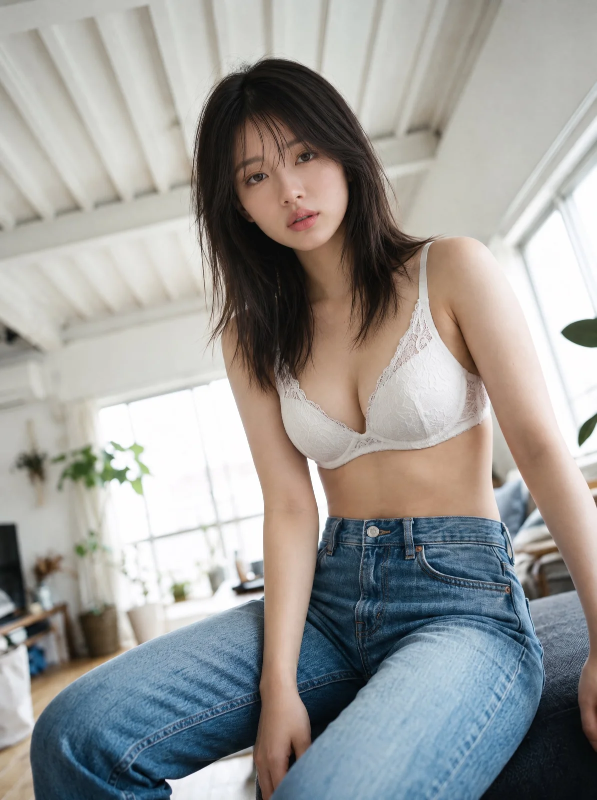

# Photoreal Low-Angle Portrait: Woman in a White Lace Bra and Blue Jeans

**中文标题：** 写实低机位肖像：白蕾丝内衣与蓝色牛仔裤  
**ID:** `gi25-x-1608` · **Mode:** `generate`  
**Categories:** `general`  
**Tags:** `x-twitter`, `community`, `gpt-image-2.5`, `x-direct`, `en`



### Photoreal Low-Angle Portrait: Woman in a White Lace Bra and Blue Jeans

```text
Photorealistic Subject & Action: Low-angle candid photo of a young Japanese woman, smiling gently, looking down at the camera. 

A refined, naturally proportioned feminine nose with a moderately slender, smooth nasal bridge and a softly rounded, gently full nasal tip. Delicate but not overly thin, softly defined rather than sharply pointed, with subtle natural curvature, balanced projection, and harmonious facial proportions. Elegant, realistic, and naturally soft. 

She wears a white lace bra and blue denim jeans. 

The subject's body is oriented at a three-quarter angle of about 20–25° toward the lens, with the chest mostly facing the camera, but the pelvis gently pushed out toward the subject's right side, creating a pronounced natural S-curve in the waist. The subject's right hip is slightly turned outward, the left leg closer to the lens, making the left thigh appear wider and fuller at the bottom of the frame; the other leg slightly back, no need for an obvious step. No stiff frontal stance, no excessive waist twisting.

Bright, modern interior with a white slatted ceiling and a large window in the background. Dutch angle, three quarters body medium shot. Soft, diffused natural light. Realistic, high-resolution, wide-angle photography. 

Sony A7R IV photography, natural perspective, clean aesthetic, bright and airy composition. 

High-resolution image; natural details in skin, sub surface scattering, and hair. No filters or AI effects; not a drawing, cartoon, or anime. 

The overall style is hyperrealistic photography, 8K resolution, extremely high image quality, finely detailed skin texture, shallow depth of field, and cinematic lighting and shadows
```

- **Recommended model:** `gpt-image-2.5-sunburst`
- **Settings:** _(defaults)_
- **Source:** [community](https://x.com/tealdog2/status/2123485116563595738) — @tealdog2
- **License note:** Original public X post; quoted with attribution — remix with attribution
- **Notes:** Collected directly from X; original post https://x.com/tealdog2/status/2123485116563595738; post text names GPT Image 2.5; discovered via X search, prompt re-verified against the original X post via api.fxtwitter.com; verified=True; comparison post of four models; GPT Image 2.5 Sunburst is image 3, which is used as the preview
- **Preview:** `previews/gi25-x-1608.webp`
