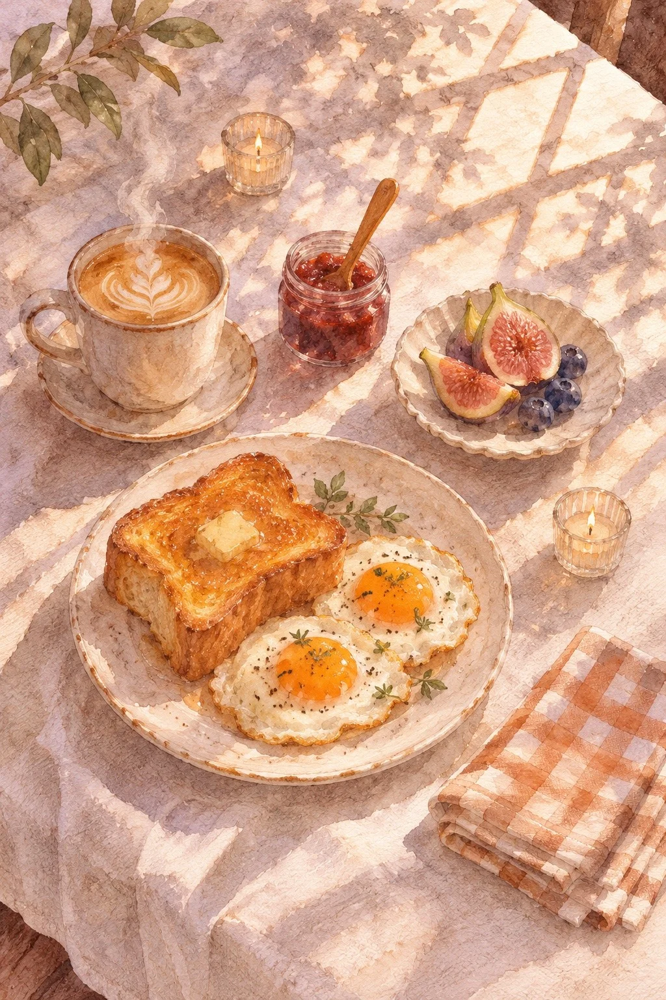

# Overhead Watercolor: Brunch on a Sunlit White Tablecloth (2:3)

**中文标题：** 俯拍水彩：阳光桌布上的早午餐（2:3）  
**ID:** `gi25-x-1610` · **Mode:** `generate`  
**Categories:** `general`  
**Tags:** `x-twitter`, `community`, `gpt-image-2.5`, `x-direct`, `zh`



### Overhead Watercolor: Brunch on a Sunlit White Tablecloth (2:3)

```text
Create an image with the following visual system. Replace the subject as specified.

Visual system (light, color, composition, medium, mood):
【画面风格】一张竖幅约 2:3 的写实水彩画，湿画法晕染加干笔收边，颜色在纸上自然化开、边缘有水渍和留白，能看到水彩纸的粗颗粒，物件轮廓带一点铅笔底稿的细线。机位从正上方略斜着往下俯拍一张铺着白色亚麻桌布的桌子，桌布有柔软的褶皱，桌子边缘斜着出画，左下和右上角露出一点深棕色的木地板或椅子暗部。桌上的东西沿着一条斜线错落摆开，有大有小，彼此留出空隙，不挤成一团。午后的阳光从画面右上方斜斜照进来，透过窗格和窗外的树叶，在桌布上投下一道道斜长的窗影和斑驳的叶影，亮处是暖白，影子是透明的灰紫和暖棕。几个小小的玻璃杯蜡烛点在桌上，火光很小。色彩：暖白桌布占大半，主体的颜色集中在橙、焦糖棕、蜂蜜黄，少量橄榄绿叶子点缀，暗部用暖棕灰压住。整体安静、温暖、慢悠悠，像周末中午太阳刚好晒到桌上。画面里没有人也没有动物，只能看到桌面。不要 3D，不要照片质感，不要文字、签名和水印。

New subject:
【主体】一桌早午餐：一盘煎得金黄的厚吐司配两个太阳蛋，一小罐深红色草莓果酱插着木勺，一杯拿铁冒着热气，一碟切开的无花果和几颗蓝莓，一块叠起来的格子餐巾。
```

- **Recommended model:** `gpt-image-2.5-flare`
- **Settings:** _(defaults)_
- **Source:** [community](https://x.com/static_stare/status/2123636628698919307) — @static_stare
- **License note:** Original public X post; quoted with attribution — remix with attribution
- **Notes:** Collected directly from X; original post https://x.com/static_stare/status/2123636628698919307; post text names GPT Image 2.5; discovered via X search, prompt re-verified against the original X post via api.fxtwitter.com; verified=True; visual-system + replaceable-subject template; prompt for image 1 of 4 (the author offers the other three on request); post names GPT Image 2.5 without a Flare/Sunburst variant; preview is image 1
- **Preview:** `previews/gi25-x-1610.webp`
