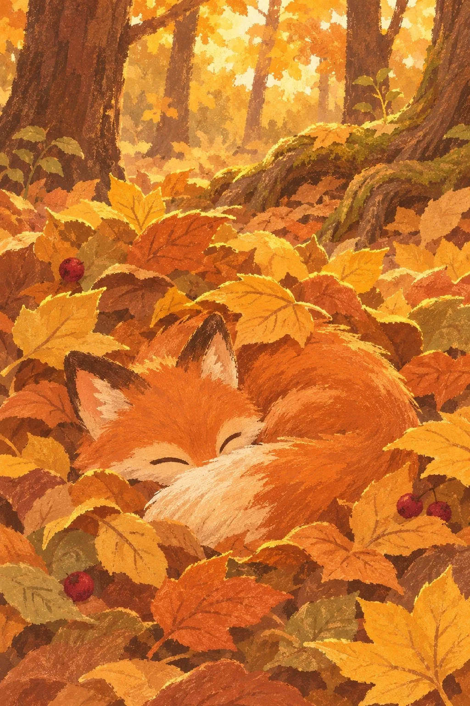

# Picture-Book Gouache: Fox Curled Asleep in a Pile of Autumn Leaves (2:3)

**中文标题：** 绘本颗粒插画：蜷在秋日落叶堆里的小狐狸（2:3）  
**ID:** `gi25-x-1612` · **Mode:** `generate`  
**Categories:** `general`  
**Tags:** `x-twitter`, `community`, `gpt-image-2.5`, `x-direct`, `zh`



### Picture-Book Gouache: Fox Curled Asleep in a Pile of Autumn Leaves (2:3)

```text
Create an image with the following visual system. Replace the subject as specified.

Visual system (light, color, composition, medium, mood):
【画面风格】一张竖幅约 2:3 的秋天绘本插画，平涂色块加细密的颗粒和干笔纹理，像用粗糙的数字笔刷模仿水粉和蜡笔印在纸上，边缘略带毛刺，没有光滑渐变。机位略微俯视的近景：画面下半部是一大片层层叠叠的落叶堆，叶子是芥末黄、橘橙、焦糖棕和一点枯绿，每片叶子用两三块平色加几道叶脉画成，主体窝在叶堆正中偏下的位置，一半被叶子埋住，像在里面睡着了或者安安静静待着。上半部是虚一点的树林背景：几根深棕色粗树干、一截长着青苔的老树根，远处是暖黄色逆光的树林，像午后的阳光从树后透过来。叶堆里零星散着三四颗小小的深红色野果，是全图最跳的点缀色。光从画面上方偏后来，暖金色，叶子边缘有一圈亮黄受光，叶堆底下是暖棕的阴影。色彩：暖橙黄占大半，焦糖棕和深咖啡压住暗部，少量灰绿，红果点缀。整体安静、暖和、软乎乎，像秋天午后在落叶里打个盹。不要 3D，不要照片质感，不要文字、签名和水印。

New subject:
【主体】一只橘红色的小狐狸，蜷成一团睡在落叶堆里，蓬松的大尾巴绕过来盖住鼻子，尾巴尖是白色，耳朵尖是深棕色，眼睛眯成两道弯线。
```

- **Recommended model:** `gpt-image-2.5-flare`
- **Settings:** _(defaults)_
- **Source:** [community](https://x.com/static_stare/status/2123659324203708918) — @static_stare
- **License note:** Original public X post; quoted with attribution — remix with attribution
- **Notes:** Collected directly from X; prompt posted as the author's own reply https://x.com/static_stare/status/2123659324203708918 to https://x.com/static_stare/status/2123274888664465616, which carries the images; GPT Image 2.5 is named in the reply; discovered via X search, prompt re-verified against the original X post via api.fxtwitter.com; verified=True; additional subject from the author's 2026-11-19 leaf-pile series (image 1 already collected as gi25-x-1596); prompt posted later as a reply; GPT Image 2.5 is named in the parent; preview is parent image 4
- **Preview:** `previews/gi25-x-1612.webp`
