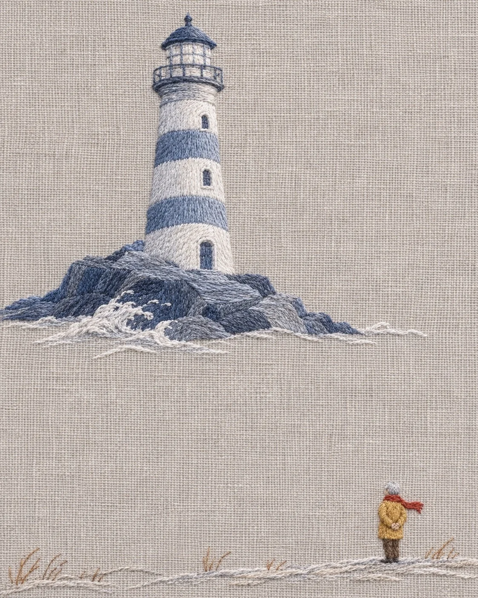

# Linen Embroidery: A Lighthouse and a Tiny Yellow-Coated Figure

**中文标题：** 布面刺绣：礁石灯塔与黄外套小人  
**ID:** `gi25-x-1615` · **Mode:** `generate`  
**Categories:** `general`  
**Tags:** `x-twitter`, `community`, `gpt-image-2.5`, `x-direct`, `zh`



### Linen Embroidery: A Lighthouse and a Tiny Yellow-Coated Figure

```text
Create an image with the following visual system. Replace the subject as specified.

Visual system (light, color, composition, medium, mood):
【画面风格】一张竖幅约 4:5 的手工刺绣作品近距离实拍，底布是浅灰米色的亚麻布，布纹经纬清楚，整块底布平整，光线柔和均匀，没有强烈投影。画面里的东西全是用丝线一针一针绣上去的：长短针、缎面绣顺着形体方向走线，丝线有细微光泽，针脚之间露出一点布底，边缘微微凸起在布面上。构图大量留白：画面中上部是一个大的主景，只用灰蓝、雾蓝、白色和一点深靛蓝的线绣成，用线的方向表现明暗和体积；画面右下方很远处站着一个很小的人，衣服用明黄色和正红色的线绣，是全图唯一的鲜艳颜色，人背对或侧对观众，望着那个大东西。画面底部有一小条用白线和浅灰线绣的地面，零星几根赭石色和枯棕色的细线绣的小草。大东西和小人之间隔着一大片空布。色彩：灰米布底占大半，灰蓝白是主景，黄和红只在小人身上，很小但很跳。整体安静、空旷、有点孤单又很温柔。不要画成插画或照片，必须是真的线绣在布上的质感，不要文字、签名和水印。

New subject:
【主体】大主景是一座立在礁石上的高大灯塔，白色塔身加灰蓝色横条，礁石用深靛蓝和灰蓝线绣，塔下有几道白线绣的浪花；小人是一位戴红色围巾、穿明黄色旧外套的老人，背着手站着看灯塔。
```

- **Recommended model:** `gpt-image-2.5-flare`
- **Settings:** _(defaults)_
- **Source:** [community](https://x.com/static_stare/status/2123682573734027288) — @static_stare
- **License note:** Original public X post; quoted with attribution — remix with attribution
- **Notes:** Collected directly from X; original post https://x.com/static_stare/status/2123682573734027288; post text names GPT Image 2.5; discovered via X search, prompt re-verified against the original X post via api.fxtwitter.com; verified=True; visual-system + replaceable-subject template; prompt for image 1 of 4 (the author offers the other three on request); post names GPT Image 2.5 without a Flare/Sunburst variant; preview is image 1
- **Preview:** `previews/gi25-x-1615.webp`
