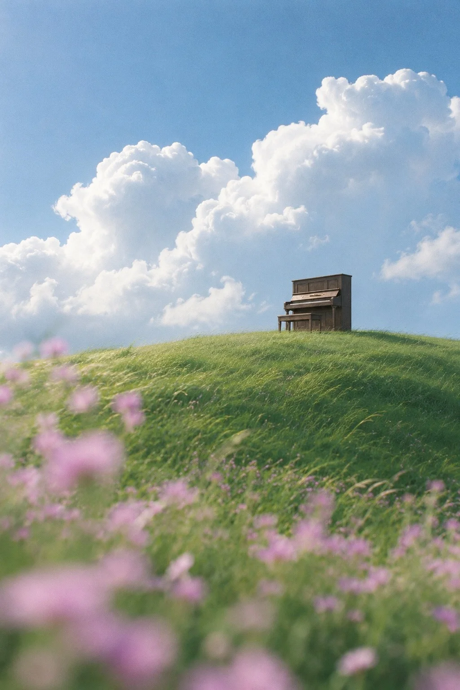

# Cinematic Surreal: An Old Upright Piano on a Grassy Hilltop

**中文标题：** 电影感超现实：绿草丘顶上的旧立式钢琴  
**ID:** `gi25-x-1617` · **Mode:** `generate`  
**Categories:** `general`  
**Tags:** `x-twitter`, `community`, `gpt-image-2.5`, `x-direct`, `zh`



### Cinematic Surreal: An Old Upright Piano on a Grassy Hilltop

```text
Create an image with the following visual system. Replace the subject as specified.

Visual system (light, color, composition, medium, mood):
【画面风格】一张竖幅约 2:3 的电影感超现实摄影，像用胶片拍的电影剧照，有细微颗粒，色彩干净柔和。机位贴近草地、略仰视：画面下半部是一座圆润的绿色草丘，坡顶在画面中部偏右，草丘被风吹得草叶微微倒向一边；前景离镜头很近的地方是一丛丛粉紫色的小野花，被大光圈虚化成柔软的色斑，占据画面下方和左下角，焦点落在坡顶。坡顶上孤零零地放着一样不该出现在野外的东西，很小，静静地待着，四周什么都没有。天空占画面上半部，是晴朗的天蓝色，堆着大团蓬松的白色积云，云朵边缘被阳光照得很亮。光是上午偏晴的自然阳光，从左上方照过来，草丘顶部和那样东西被照亮，草丘背光面是深一点的橄榄绿。色彩：天蓝、云白、草绿三大块，前景粉紫花点缀。画面里没有人，没有动物，没有房子和路。整体安静、空旷、有点孤独又有点梦，像一部电影的开场镜头。不要文字、签名和水印。

New subject:
【主体】坡顶放着一架旧的立式木头钢琴，深棕色，琴盖打开，露出一排黑白琴键，琴凳摆在前面，没有人在弹。
```

- **Recommended model:** `gpt-image-2.5-flare`
- **Settings:** _(defaults)_
- **Source:** [community](https://x.com/static_stare/status/2123750414910886163) — @static_stare
- **License note:** Original public X post; quoted with attribution — remix with attribution
- **Notes:** Collected directly from X; original post https://x.com/static_stare/status/2123750414910886163; post text names GPT Image 2.5; discovered via X search, prompt re-verified against the original X post via api.fxtwitter.com; verified=True; visual-system + replaceable-subject template; prompt for image 1 of 4 (the author offers the other three on request); post names GPT Image 2.5 without a Flare/Sunburst variant; preview is image 1
- **Preview:** `previews/gi25-x-1617.webp`
