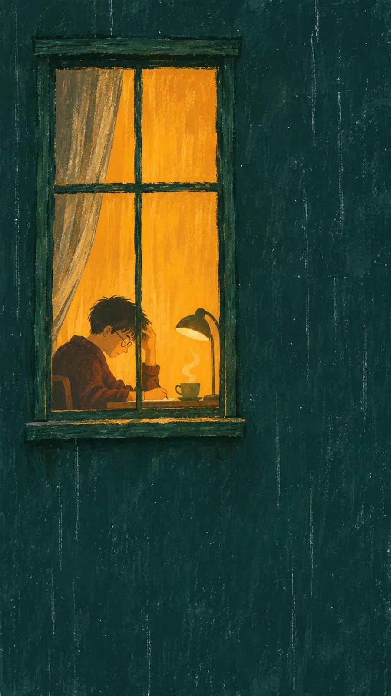

# Hand-Drawn Night Scene: A Lit Window with a Young Man Writing

**中文标题：** 手绘夜景：楼下看见的一扇亮窗与写字的人  
**ID:** `gi25-x-1619` · **Mode:** `generate`  
**Categories:** `general`  
**Tags:** `x-twitter`, `community`, `gpt-image-2.5`, `x-direct`, `zh`



### Hand-Drawn Night Scene: A Lit Window with a Young Man Writing

```text
Create an image with the following visual system. Replace the subject as specified.

Visual system (light, color, composition, medium, mood):
【画面风格】一张竖幅约 9:16 的手绘插画，像用粗颗粒的数字笔刷模仿水粉和蜡笔画在纸上，平涂色块带干刷纹理和细小的白色噪点，轮廓用深墨绿的手抖线勾出，线条有粗有细、有断口。画面是从外面看一栋楼的外墙：整面墙是深青色接近墨蓝绿，带着粗糙的颗粒和几道竖向的雨痕划痕，墙上只开着一扇高高的竖长窗户，偏左放在画面上半到中部，四周是大片深色墙面。窗框是深青绿的木框，十字窗格，左边挂着一幅半拉开的灰米色薄窗帘。窗里亮着灯，整片窗是暖暖的琥珀黄和蜂蜜色，用粗笔刷竖着刷出深浅，像台灯的光铺满了小房间。窗户下沿是一条窄窄的窗台，主体就在窗台后面和窗台上，被琥珀色的光衬成剪影感的暗色块，细节很少，几笔带过。只有琥珀色窗光和深青色墙两大色块，加一点点主体身上的暗绿、暗红或深棕。整体安静、孤单又温暖，像深夜走在楼下，抬头看到还亮着的一扇窗。画面里不要酒瓶和酒杯，不要文字、签名和水印。

New subject:
【主体】窗后是一个短发戴圆框眼镜的男生，侧身坐着，低头在写字台上写东西，一只手撑着额头，窗台上放着一盏小台灯和一杯冒着热气的茶。
```

- **Recommended model:** `gpt-image-2.5-flare`
- **Settings:** _(defaults)_
- **Source:** [community](https://x.com/static_stare/status/2123781223466074364) — @static_stare
- **License note:** Original public X post; quoted with attribution — remix with attribution
- **Notes:** Collected directly from X; original post https://x.com/static_stare/status/2123781223466074364; post text names GPT Image 2.5; discovered via X search, prompt re-verified against the original X post via api.fxtwitter.com; verified=True; visual-system + replaceable-subject template; prompt for image 1 of 4 (the author offers the other three on request); post names GPT Image 2.5 without a Flare/Sunburst variant; preview is image 1
- **Preview:** `previews/gi25-x-1619.webp`
