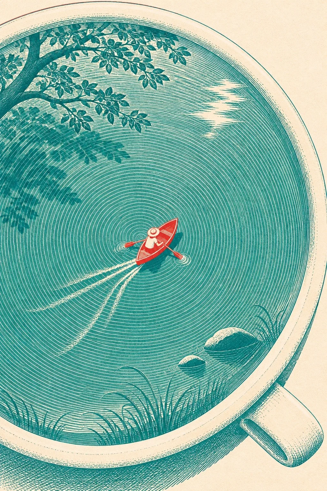

# Two-Color Print: A Coffee Cup That Becomes a Lake with a Rowboat

**中文标题：** 双色版画：咖啡杯里的一圈涟漪变成小湖  
**ID:** `gi25-x-1623` · **Mode:** `generate`  
**Categories:** `general`  
**Tags:** `x-twitter`, `community`, `gpt-image-2.5`, `x-direct`, `zh`



### Two-Color Print: A Coffee Cup That Becomes a Lake with a Rowboat

```text
Create an image with the following visual system. Replace the subject as specified.

Visual system (light, color, composition, medium, mood):
【画面风格】一张竖幅约 2:3 的双色丝网版画风概念插画，只用湖青色和朱红色两种油墨，再加米白色纸底，像手工套印的杂志插图：湖青色有深浅三四个层次，大量用密集的同心细线、像刻刀刻出来的平行线条去表现纹理和水波，线条之间露出一丝丝纸白；朱红色只用在主体里指定的几个点睛小东西上，红色是平涂，边缘带一点油墨颗粒，有一点点套色错位。机位是正上方垂直俯视：一个日常生活里的圆形物件占满画面大部分，被画面边缘裁掉一角，露出外面的米白纸底。这个物件自己的圆形纹路在画面里慢慢变成了一片风景，同心圆既是物件的纹理，也是水面的涟漪或者地面的纹路，物件和风景之间没有边界。风景里只有几个很小的东西在动，小东西用朱红色点缀，带一点白色高光，下面投出一点深青色的小影子。整体安静、巧妙、带一点幽默。不要文字、数字、字母、品牌、logo、签名和水印。

New subject:
【主体】一杯咖啡，从正上方看，外圈是一圈米白的陶瓷杯沿，旁边露出一点杯把；杯里的液面变成一片湖青色的小湖，表面的一圈圈同心纹就是湖面的涟漪，湖心一条朱红色的小划艇，船上一个小人在划桨，船后拖出一道 V 形的白色水纹。
```

- **Recommended model:** `gpt-image-2.5-flare`
- **Settings:** _(defaults)_
- **Source:** [community](https://x.com/static_stare/status/2124044391329522044) — @static_stare
- **License note:** Original public X post; quoted with attribution — remix with attribution
- **Notes:** Collected directly from X; original post https://x.com/static_stare/status/2124044391329522044; post text names GPT Image 2.5; discovered via X search, prompt re-verified against the original X post via api.fxtwitter.com; verified=True; visual-system + replaceable-subject template; prompt for image 1 of 4 (the author offers the other three on request); post names GPT Image 2.5 without a Flare/Sunburst variant; preview is image 1
- **Preview:** `previews/gi25-x-1623.webp`
