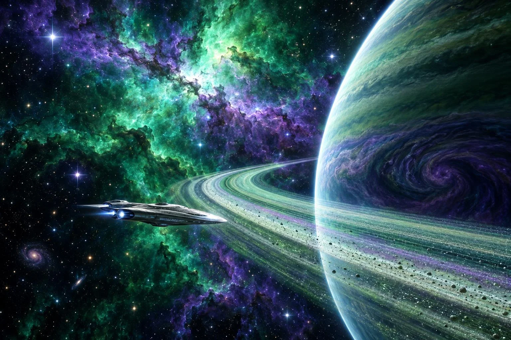

# Lone Silver Starship Passing a Ringed Planet in a Nebula

**中文标题：** 银色孤独飞船掠过星云中的环状行星  
**ID:** `gi25-x-1628` · **Mode:** `generate`  
**Categories:** `general`  
**Tags:** `x-twitter`, `community`, `gpt-image-2.5`, `x-direct`, `en`



### Lone Silver Starship Passing a Ringed Planet in a Nebula

```text
A lone silver starship glides silently past the luminous arc of a colossal ringed planet, dwarfed by the vast, swirling emerald-and-violet nebula that bathes the scene in ethereal light while distant stars blaze like diamonds across the infinite darkness.
```

- **Recommended model:** `gpt-image-2.5-flare`
- **Settings:** _(defaults)_
- **Source:** [community](https://x.com/Yeti_Images/status/2124299322753761430) — @Yeti_Images
- **License note:** Original public X post; quoted with attribution — remix with attribution
- **Notes:** Collected directly from X; original post https://x.com/Yeti_Images/status/2124299322753761430; post text names GPT Image 2.5; discovered via X search, prompt re-verified against the original X post via api.fxtwitter.com; verified=True; post names gpt-image-2.5-flare; the stored prompt is the complete alt text (the tweet body is truncated with 'See alt text for more')
- **Preview:** `previews/gi25-x-1628.webp`
