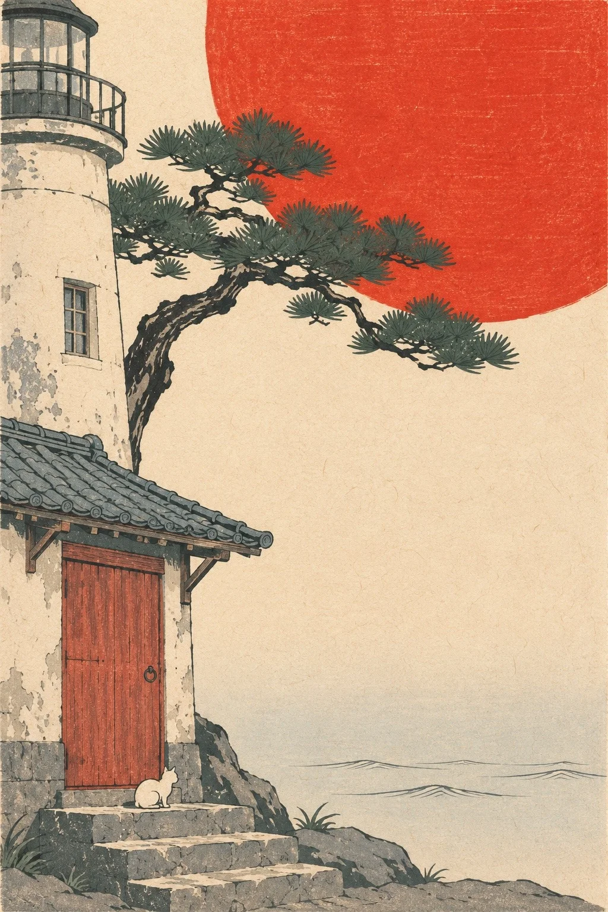

# Ukiyo-e Woodcut: A Seaside Lighthouse Against a Huge Red Sun

**中文标题：** 浮世绘木刻：海边老灯塔与出框的朱红太阳  
**ID:** `gi25-x-1630` · **Mode:** `generate`  
**Categories:** `general`  
**Tags:** `x-twitter`, `community`, `gpt-image-2.5`, `x-direct`, `ja`



### Ukiyo-e Woodcut: A Seaside Lighthouse Against a Huge Red Sun

```text
Create an image with the following visual system. Replace the subject as specified.

Visual system (light, color, composition, medium, mood):
【画面风格】一张竖幅约 2:3 的现代浮世绘木版套色画（日本传统木刻版画的印法，不是丝网、不是孔版、没有网点），印在微微泛黄的厚和纸上，纸面看得到细长的纤维和纸张颗粒。画面左侧或一侧是一座近景的老建筑，只露出一部分，被画面边缘裁掉，带着瓦檐、木格子或木门窗的结构，建筑后面是一大片空旷的米白色天空或墙面；画面另一侧高处挂着一轮超大的圆形天体，大到被画面边缘裁掉一截，是一整块平涂的饱和色块，边缘干净利落。前景从建筑上垂下一丛藤蔓或枝叶，叶片是一片片剪影式的墨绿灰平涂小色块，叶子边缘有木刻刀口那种略带棱角的利落感，叶丛压过天体的边缘形成前后层次。画面下方是几级石阶或一小块地面，远处只留一个很小的安静人影或干脆没有人，大面积留白。所有颜色都是一块块平涂的木版套色，每块色面里能看到浅浅的木纹肌理和水性颜料印刷时的不均匀斑驳，大色块边缘有极细的套色错位；建筑轮廓、瓦片和格子用浮世绘那种细而稳的墨色线条勾出，局部天空或墙面底部有一点浮世绘式的上浓下淡渐层（ぼかし）。整张限色：一种饱和的天体主色、灰青/石板灰、墨绿灰、米白和纸色、少量深墨色，不超过五六种。光是均匀柔和的白天散光，不画真实投影，只有建筑下方一块深色阴面。气氛安静、留白多、像午后发呆。画面里不要任何文字、印章、签名、落款和水印。

New subject:
【主体】近景是一座海边老灯塔的下半截和一间守塔人的小屋，白墙有点斑驳，小屋是灰青瓦檐和朱红色木门，门前三级石阶；塔边伸出一棵歪脖子黑松，松针一簇簇压在天体边缘。天体是一轮超大的朱红色太阳。远处海面只用几道浮世绘式的细浪线带过，石阶上蹲着一只很小的白猫。
```

- **Recommended model:** `gpt-image-2.5-flare`
- **Settings:** _(defaults)_
- **Source:** [community](https://x.com/static_stare/status/2124362760167575832) — @static_stare
- **License note:** Original public X post; quoted with attribution — remix with attribution
- **Notes:** Collected directly from X; original post https://x.com/static_stare/status/2124362760167575832; post text names GPT Image 2.5; discovered via X search, prompt re-verified against the original X post via api.fxtwitter.com; verified=True; visual-system + replaceable-subject template; prompt for image 1 of 4 (the author offers the other three on request); post names GPT Image 2.5 without a Flare/Sunburst variant; preview is image 1
- **Preview:** `previews/gi25-x-1630.webp`
