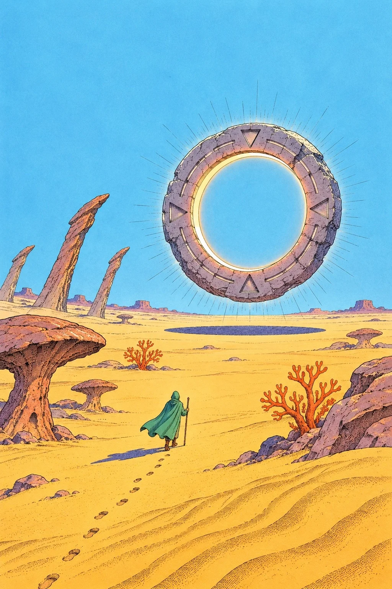

# French Comic Flat Color: A Small Figure Walking Toward a Stone Ring

**中文标题：** 法式漫画线稿平涂：异星沙漠里走向石环的小人  
**ID:** `gi25-x-1636` · **Mode:** `generate`  
**Categories:** `general`  
**Tags:** `x-twitter`, `community`, `gpt-image-2.5`, `x-direct`, `zh`



### French Comic Flat Color: A Small Figure Walking Toward a Stone Ring

```text
Create an image with the following visual system. Replace the subject as specified.

Visual system (light, color, composition, medium, mood):
【画面风格】一张竖幅约 2:3 的 70–80 年代法式科幻漫画（bande dessinée）风格插画，干净利落的黑色钢笔线稿加平涂上色，像漫画画册里的一整页单幅大图。线条细而肯定、粗细变化克制，阴影用细密的平行排线和点描表现，不用渐变喷枪；颜色是一块块平涂的水彩感色面，边界清楚，只在高光和发光物周围留一点白。画面是一片辽阔的异星沙漠，从近景一直铺到很低的地平线：近景是大片明亮的金黄色沙地，沙面有几道弧形的沙纹和一串小脚印；中景散落着形状奇怪的蘑菇状岩石、低矮的外星植物和巨大的风化石柱；画面上方三分之一以上是大面积干净的天青色天空，几乎不画云，留出大块空白。画面里有一个很小的人物，穿着带兜帽的长袍，背对或侧对观众，独自走在沙地上，人物小到只占画面很小一块，用一块饱和的颜色把他从金黄沙地上点出来。远处有一件巨大的、神秘的异物作为视觉焦点，周围有一圈细线画出的放射光芒。光线是高处来的明亮日光，沙地上有清晰的蓝紫色投影。色彩：金黄和赭橙的沙地、天青色天空、紫褐色和砖红的岩石，加一两处饱和的点缀色。气氛辽阔、寂静、神秘，带一点探险感。画面里不要任何文字、对话框、署名、签名、落款和水印。

New subject:
【主体】远处焦点是一个悬浮在半空中的巨大石环，石环表面是风化的灰紫色岩石，刻着一圈简单的几何凹纹，环中间透出一圈淡金色的光；石环正下方的沙地上投着一个椭圆形的影子。中景是几根被风吹斜的细高石柱和几株珊瑚一样的橙红色植物。近景走着一个穿青绿色兜帽长袍、拄着长杖的小人，正朝石环走去。
```

- **Recommended model:** `gpt-image-2.5-flare`
- **Settings:** _(defaults)_
- **Source:** [community](https://x.com/static_stare/status/2124475198217007333) — @static_stare
- **License note:** Original public X post; quoted with attribution — remix with attribution
- **Notes:** Collected directly from X; original post https://x.com/static_stare/status/2124475198217007333; post text names GPT Image 2.5; discovered via X search, prompt re-verified against the original X post via api.fxtwitter.com; verified=True; visual-system + replaceable-subject template; prompt for image 1 of 4 (the author offers the other three on request); post names GPT Image 2.5 without a Flare/Sunburst variant; preview is image 1
- **Preview:** `previews/gi25-x-1636.webp`
