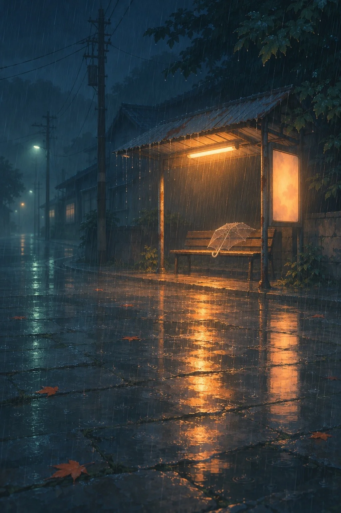

# Anime Background: A Rainy Night Bus Shelter Lit in Warm Yellow

**中文标题：** 动画背景：雨夜里亮着暖黄灯的公交站棚  
**ID:** `gi25-x-1637` · **Mode:** `generate`  
**Categories:** `general`  
**Tags:** `x-twitter`, `community`, `gpt-image-2.5`, `x-direct`, `zh`



### Anime Background: A Rainy Night Bus Shelter Lit in Warm Yellow

```text
Create an image with the following visual system. Replace the subject as specified.

Visual system (light, color, composition, medium, mood):
【画面风格】一张竖幅约 2:3 的日系动画电影背景美术风格画面，手绘数字绘画质感，像动画里一个安静的空镜。深夜下着雨，一条无人的街角，画面主体是一小块亮着暖光的东西，放在画面中间偏一侧，占画面不到三分之一，其余大部分沉在深蓝青色的夜色里。近景是大片被雨打湿的旧石板路面，石板缝里积着水，地面像镜子一样拉出长长的、被雨点打碎的橘黄色倒影和一点冷青色倒影，地上零星散落着几片橘红色的落叶。中景和远景是沉在雨雾里的低矮老房子、电线杆和几根交错的电线，远处有几盏模糊的小路灯，颜色被雾吃掉一半。细细的雨丝斜着落下，在暖光附近看得最清楚，光源周围有一层柔和的光晕和水汽。光：唯一的主光是那一小块东西发出的暖橘黄光，色温很暖，只照亮它周围一小圈地面；其余是冷蓝青的环境光，暖冷对比明显但整体压得很暗。色彩：深靛蓝、蓝青、墨绿占大部分，暖橘黄只占一小块，点缀几片橘红落叶。质感是柔和的笔刷和细腻的光晕，边缘略软，不是照片。气氛安静、潮湿、适合深夜一个人看，街上没有人，或者只有一个很小很远的背影。画面里不要任何可读文字、招牌字、汉字、英文、数字、logo、签名和水印，所有招牌和标签都是空白或模糊色块。

New subject:
【主体】那一小块亮着的东西是路边一个老式公交站棚：铁皮小顶棚、两根细柱子、一张空着的长木椅，棚顶下面亮着一根暖黄的灯管，棚子侧面是一块发着柔光的空白灯箱，灯箱里只有模糊的暖色块，没有字；雨水顺着棚檐滴成一排水线。站棚里没有人，长椅上放着一把被遗忘的透明雨伞。
```

- **Recommended model:** `gpt-image-2.5-flare`
- **Settings:** _(defaults)_
- **Source:** [community](https://x.com/static_stare/status/2124504580876837193) — @static_stare
- **License note:** Original public X post; quoted with attribution — remix with attribution
- **Notes:** Collected directly from X; original post https://x.com/static_stare/status/2124504580876837193; post text names GPT Image 2.5; discovered via X search, prompt re-verified against the original X post via api.fxtwitter.com; verified=True; visual-system + replaceable-subject template; prompt for image 1 of 4 (the author offers the other three on request); post names GPT Image 2.5 without a Flare/Sunburst variant; preview is image 1
- **Preview:** `previews/gi25-x-1637.webp`
