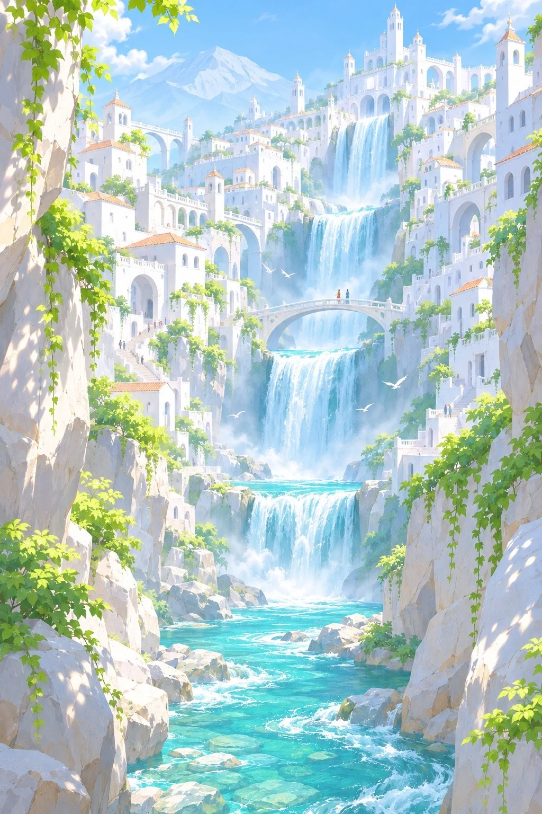

# Bright Fantasy Concept: A White City Growing Along a Canyon Waterfall

**中文标题：** 明亮奇幻概念画：瀑布边层层生长的白城  
**ID:** `gi25-x-1639` · **Mode:** `generate`  
**Categories:** `general`  
**Tags:** `x-twitter`, `community`, `gpt-image-2.5`, `x-direct`, `zh`



### Bright Fantasy Concept: A White City Growing Along a Canyon Waterfall

```text
Create an image with the following visual system. Replace the subject as specified.

Visual system (light, color, composition, medium, mood):
【画面风格】一张竖幅约 2:3 的明亮奇幻概念场景插画，像动画电影的背景美术，数字绘画，大块平涂加柔和渐变，边缘干净，不是线稿也不是照片。机位在峡谷里偏高处，往上、往深处看：画面是一道又深又窄的峡谷，两侧近景是高耸的浅色岩壁，被画面左右边缘裁掉，岩壁上挂着一簇簇鲜绿的灌木和垂藤；从中景到远景，一座由许多白色方块房子、拱门、塔楼和石阶层层堆起来的城，沿着峡谷两侧一路长到画面顶部，房子之间用白色石拱桥连起来；峡谷底部是一条清澈发亮的碧蓝色水道，从前景向深处蜿蜒，浅处能看见水底的浅色石头和白色水花。画面上方露出一条明亮的天蓝色天空，远处有一座淡到发白的大山影子。光是接近正午的强烈阳光，从左上方照进来，白墙亮面几乎发白，阴面是带一点蓝紫的冷色，阳光在水面和墙上落下柔和的亮斑，空气里有一层薄薄的蓝白色雾气，让远景越来越淡。整体只用白、天蓝、碧蓝青、鲜嫩草绿和少量暖赭石（屋顶瓦片和岩石暗部），高明度、低反差、干净通透。建筑细节多，但统一成白色体块；人物极小，只是桥上或台阶上几个小人影点。气氛开阔、清爽，像中午眯着眼看到一座城。画面里不要任何文字、标志、签名和水印。

New subject:
【主体】白城沿着一道多级大瀑布的两侧层层往上长，瀑布从城中央最高处分三四层落下，每层都落进一个碧蓝色的水潭，最下面汇成峡谷底的水道；一座细长的白色石拱桥正好横跨在瀑布中段，桥上有两个很小的人影，几只白鸟从水雾里飞过。
```

- **Recommended model:** `gpt-image-2.5-flare`
- **Settings:** _(defaults)_
- **Source:** [community](https://x.com/static_stare/status/2124724169980215638) — @static_stare
- **License note:** Original public X post; quoted with attribution — remix with attribution
- **Notes:** Collected directly from X; original post https://x.com/static_stare/status/2124724169980215638; post text names GPT Image 2.5; discovered via X search, prompt re-verified against the original X post via api.fxtwitter.com; verified=True; visual-system + replaceable-subject template; prompt for image 1 of 4 (the author offers the other three on request); post names GPT Image 2.5 without a Flare/Sunburst variant; preview is image 1
- **Preview:** `previews/gi25-x-1639.webp`
