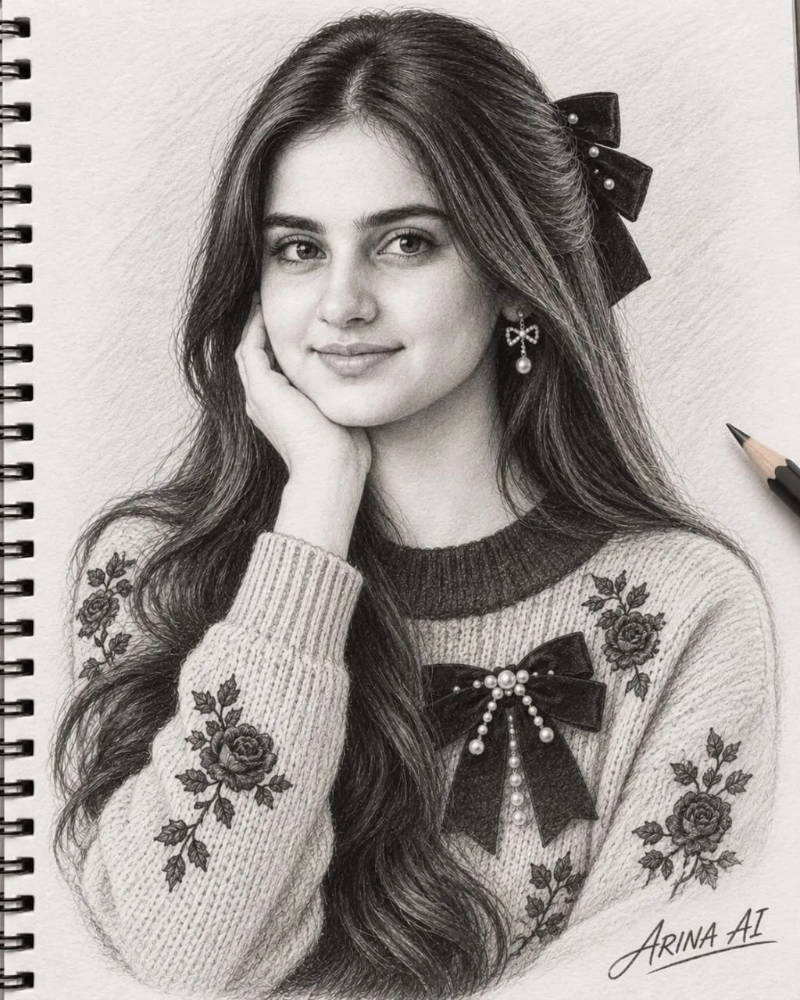

# Graphite Sketchbook Portrait: Woman in an Embroidered Sweater

**中文标题：** 素描本石墨肖像：绣花毛衣与珍珠蝴蝶结  
**ID:** `gi25-x-1640` · **Mode:** `generate`  
**Categories:** `general`  
**Tags:** `x-twitter`, `community`, `gpt-image-2.5`, `x-direct`, `en`



### Graphite Sketchbook Portrait: Woman in an Embroidered Sweater

```text
Create an ultra-realistic, highly detailed black-and-white graphite pencil portrait drawing on a white spiral-bound sketchbook page.

A beautiful young woman with long, thick, naturally wavy dark hair, styled half-up with an elegant black bow decorated with tiny pearls. She has expressive eyes, delicate facial features, a gentle smile, and elegant pearl bow-shaped drop earrings.

She is wearing a beautiful knitted sweater with a dark ribbed high neckline, intricate hand-embroidered floral roses and leaves, and a large decorative black bow with pearl embellishments on the chest. One hand is gently resting against her cheek.

ART STYLE:
Extremely realistic hand-drawn graphite pencil portrait, professional hyper-realistic sketching, intricate pencil strokes, fine hair detailing, realistic skin texture, delicate shading, precise fabric knitting patterns, detailed embroidery, soft natural shadows, professional artist's sketchbook presentation.

COMPOSITION:
Portrait orientation, close-up upper-body composition, white textured sketchbook paper, visible black spiral binding along the left edge. A realistic artist's hand holding a graphite pencil appears from the right side, as if finishing the portrait.

SIGNATURE:
At the bottom-right corner, add ONLY the handwritten artistic signature:

"ARINA AI"

Make the signature elegant, black handwritten calligraphy, clearly readable and naturally integrated into the sketchbook page.

IMPORTANT:
No other text, no extra watermark, no logo, no brand name, no "ArtCraft Creations". Only the signature "ARINA AI".

Ultra-detailed, photorealistic pencil artwork, professional 8K quality, monochrome black and white, perfectly composed.
```

- **Recommended model:** `gpt-image-2.5-flare`
- **Settings:** _(defaults)_
- **Source:** [community](https://x.com/Arina_hoqe/status/2124725850637730169) — @Arina_hoqe
- **License note:** Original public X post; quoted with attribution — remix with attribution
- **Notes:** Collected directly from X; prompt posted as the author's own reply https://x.com/Arina_hoqe/status/2124725850637730169 to https://x.com/Arina_hoqe/status/2124725846619619562, which carries the images; GPT Image 2.5 is named in the parent post; discovered via X search, prompt re-verified against the original X post via api.fxtwitter.com; verified=True; prompt posted as the author's self-reply; the parent hook mentions a miniature-world / selfie template, but the published prompt is a standalone graphite portrait that asks for the handwritten signature 'ARINA AI'; post names GPT Image 2.5 without a Flare/Sunburst variant
- **Preview:** `previews/gi25-x-1640.webp`
