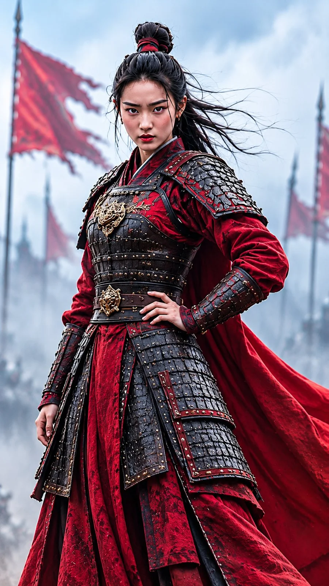

# Cinematic Portrait: East Asian Warrior in Crimson Armor (9:16)

**中文标题：** 电影感全身肖像：绯红铠甲的东亚女战士（9:16）  
**ID:** `gi25-x-1642` · **Mode:** `generate`  
**Categories:** `general`  
**Tags:** `x-twitter`, `community`, `gpt-image-2.5`, `x-direct`, `en`



### Cinematic Portrait: East Asian Warrior in Crimson Armor (9:16)

```text
Create a full-body cinematic portrait of a beautiful young East Asian female warrior standing alone, facing the camera. She has a confident yet calm facial expression, with a subtle natural smile while maintaining a strong and elegant personality. Her long black hair is styled in a traditional high bun secured with a red hair wrap, with a few loose strands naturally flowing around her face.

She wears exactly the same elaborate crimson red and black historical warrior armor: richly textured deep-red fabric underneath, dark metallic lamellar chest armor, intricately engraved silver-black shoulder plates, detailed forearm guards, ornate golden dragon-inspired chest ornament, decorated waist belt, layered armored skirt panels, and a long flowing deep-red cape extending behind her. Preserve the original costume design, colors, materials, accessories, and hairstyle.

POSE: She stands naturally and comfortably on her own, one hand resting gently on her waist while the other arm hangs relaxed beside her body. Her posture is elegant, relaxed, and confident. She is smiling softly at the camera. No weapons in her hands, no aggressive expression, no fighting stance.

BACKGROUND: A beautiful soft, misty historical outdoor environment with distant red flags, subtle silhouettes of ancient battlefield structures, and a pale cloudy sky. The background is softly blurred, creating natural depth while keeping the character as the main focus. The atmosphere feels peaceful rather than dangerous or battle-oriented.

CAMERA: Vertical 9:16 composition, full-body framing, slightly low camera angle, character centered, realistic proportions, detailed facial features, natural skin texture, realistic armor reflections, soft diffused daylight, cinematic depth of field, professional historical movie character photography.

IMPORTANT: Only one woman in the image. No horse, no other foreground characters, no sword, no combat, no action scene, no blood, no violence, no text, no watermark. Maintain the exact original warrior costume identity.
```

- **Recommended model:** `gpt-image-2.5-flare`
- **Settings:** _(defaults)_
- **Source:** [community](https://x.com/Just_Anika_Here/status/2124732828214833642) — @Just_Anika_Here
- **License note:** Original public X post; quoted with attribution — remix with attribution
- **Notes:** Collected directly from X; original post https://x.com/Just_Anika_Here/status/2124732828214833642; post text names GPT Image 2.5; discovered via X search, prompt re-verified against the original X post via api.fxtwitter.com; verified=True; prompt was posted as a JSON object; the stored text is the inner prompt string; post names GPT IMAGE 2.5 without a Flare/Sunburst variant; preview is image 1 of 2
- **Preview:** `previews/gi25-x-1642.webp`
