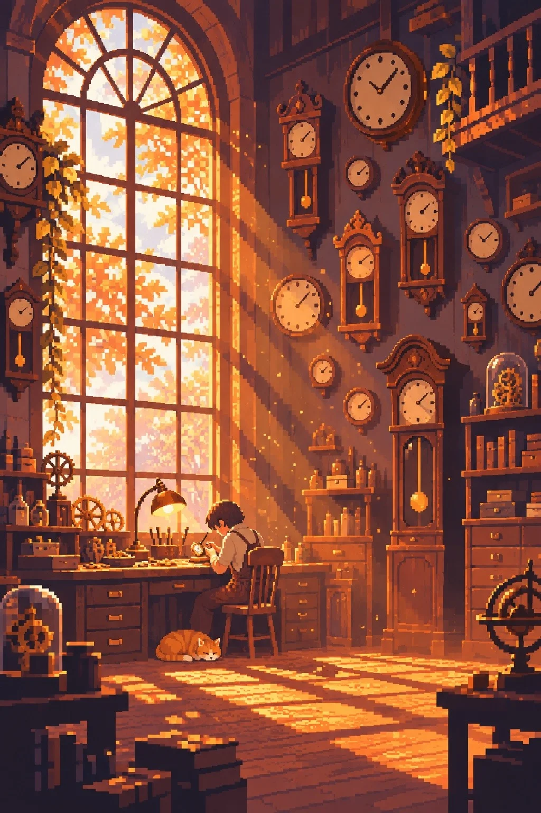

# Pixel Art: Afternoon Light in a Clock Repair Shop with an Orange Cat

**中文标题：** 像素画：午后阳光照进钟表修理铺  
**ID:** `gi25-x-1643` · **Mode:** `generate`  
**Categories:** `general`  
**Tags:** `x-twitter`, `community`, `gpt-image-2.5`, `x-direct`, `zh`



### Pixel Art: Afternoon Light in a Clock Repair Shop with an Orange Cat

```text
Create an image with the following visual system. Replace the subject as specified.

Visual system (light, color, composition, medium, mood):
【画面风格】一张竖幅约 2:3 的像素画（pixel art），像 16-bit 复古游戏里一张安静的室内场景背景，像素方块清楚可见，边缘是硬硬的方格阶梯，没有平滑抗锯齿，也没有写实笔触。画面是一个高大的室内空间，一侧是一扇几乎从地面通到画面顶部的高窗（窗的样子由主体决定），窗外是下午偏晚的强烈逆光，窗外的天和树被曝成一片奶白、浅蓝和亮橙色的像素光斑；阳光从窗口斜着涌进来，把屋里一部分照成浓烈的橙金色，另一部分沉在深棕、暗紫和墨蓝的阴影里，明暗反差很大。光柱里飘着很多一个像素大小的金色光点和灰尘。屋里堆满小物件（由主体决定），全用像素小块概括，暗处的物件只剩剪影和几颗高光像素。画面下部是一块被阳光照亮的地面，亮带像一条长长的橙黄色光斑，前景边缘压一点深色家具剪影，拉出景深。屋里只有一个很小的人，坐着或安静地做事，人物只有十几个像素高，看不清脸。整体限色：橙金、琥珀、奶白高光、深棕、暗紫、墨蓝，暖色压过冷色。气氛安静、暖，像下午三点多一个人待着不想动。画面里不要任何可读文字、数字、标志、签名和水印。

New subject:
【主体】一间老钟表修理铺，高窗是一扇上面带圆拱的木格窗；墙上挂满大大小小的挂钟和摆钟，表盘上只有小点没有数字；靠窗一张堆满齿轮和小工具的工作台，台上一盏小台灯，一个人坐在工作台前低头修表，脚边趴着一只橘猫。
```

- **Recommended model:** `gpt-image-2.5-flare`
- **Settings:** _(defaults)_
- **Source:** [community](https://x.com/static_stare/status/2124768993529741761) — @static_stare
- **License note:** Original public X post; quoted with attribution — remix with attribution
- **Notes:** Collected directly from X; original post https://x.com/static_stare/status/2124768993529741761; post text names GPT Image 2.5; discovered via X search, prompt re-verified against the original X post via api.fxtwitter.com; verified=True; visual-system + replaceable-subject template; prompt for image 1 of 4 (the author offers the other three on request); post names GPT Image 2.5 without a Flare/Sunburst variant; preview is image 1
- **Preview:** `previews/gi25-x-1643.webp`
