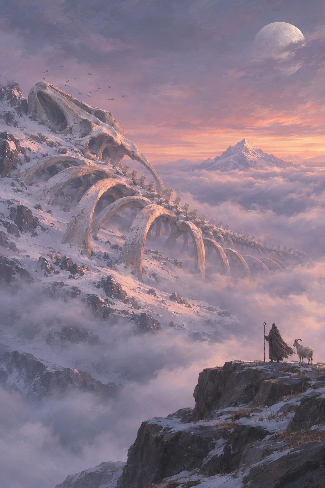

# Epic Fantasy Matte Painting: A Colossal Whale Skeleton in a Sea of Clouds

**中文标题：** 史诗奇幻绘景：云海里横躺的巨大鲸鱼骨架  
**ID:** `gi25-x-1645` · **Mode:** `generate`  
**Categories:** `general`  
**Tags:** `x-twitter`, `community`, `gpt-image-2.5`, `x-direct`, `zh`



### Epic Fantasy Matte Painting: A Colossal Whale Skeleton in a Sea of Clouds

```text
Create an image with the following visual system. Replace the subject as specified.

Visual system (light, color, composition, medium, mood):
【画面风格】一张竖幅约 2:3 的史诗奇幻概念绘景（matte painting），数字厚涂，笔触柔和但看得出画笔肌理，远处有很重的大气透视。画面左侧中景是一座被云海包围的雪山山坡，山坡上半埋着一具巨大到不合常理的遗骸（由主体决定），尺度比山还大，一部分被积雪和碎石盖住，一部分没进翻滚的云雾里，表面有风化的裂纹和积雪。画面中间远处是一座孤零零的尖顶雪山，从云海里冒出来。画面右下前景是一块深色的岩石悬崖边，悬崖上站着一个很小的人和一只动物（由主体决定），背对或侧对画面，望着那具遗骸，人只占画面高度的十分之一左右，用来对比尺度。天空是黄昏的柔和渐变：上方是灰蓝和雾紫，地平线附近是粉橘和淡金，右上角挂着一轮被薄云遮住一半的苍白大月亮；一群很小的黑色飞鸟绕着遗骸最高处盘旋。光从画面右后方低低地照过来，遗骸和山坡朝光的一面染成粉橘暖色，背光面和云海是冷冷的蓝紫灰。整体色彩：雾紫、灰蓝、粉橘、淡金、雪白，前景是深石板色，冷暖对比柔和。气氛辽阔、安静、有一点肃穆，像旅人在很远的地方看见一段很古老的东西。不要人类骷髅、不要血腥和血迹，画面里不要文字、签名和水印。

New subject:
【主体】遗骸是一具巨大的鲸鱼骨架，横躺在山坡上，长长的脊椎和一根根弯弧形的肋骨像一排拱门从雪里拱出来，巨大的头骨朝着山顶。前景悬崖上是一个披着长斗篷、拄着长杖的旅人，身边一只长毛山羊。
```

- **Recommended model:** `gpt-image-2.5-flare`
- **Settings:** _(defaults)_
- **Source:** [community](https://x.com/static_stare/status/2124836246702985363) — @static_stare
- **License note:** Original public X post; quoted with attribution — remix with attribution
- **Notes:** Collected directly from X; original post https://x.com/static_stare/status/2124836246702985363; post text names GPT Image 2.5; discovered via X search, prompt re-verified against the original X post via api.fxtwitter.com; verified=True; visual-system + replaceable-subject template; prompt for image 1 of 4 (the author offers the other three on request); post names GPT Image 2.5 without a Flare/Sunburst variant; preview is image 1
- **Preview:** `previews/gi25-x-1645.webp`
