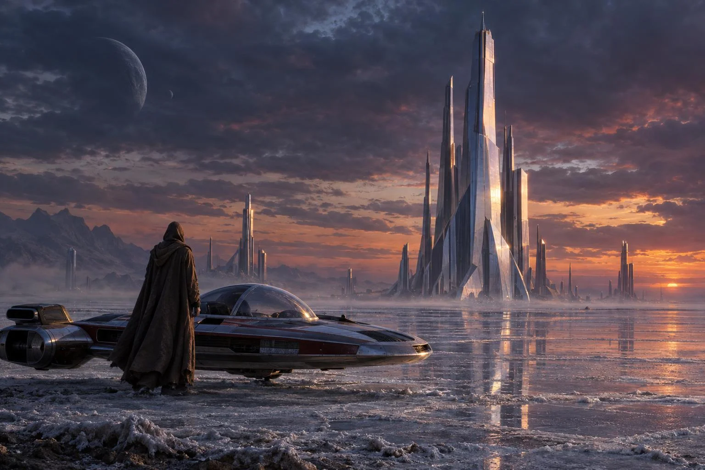

# McQuarrie-Inspired Salt Plain with Crystal Towers and a Land Speeder

**中文标题：** 麦奎里风盐碱荒原：几何白塔与气泡座舱飞行器  
**ID:** `gi25-x-1651` · **Mode:** `generate`  
**Categories:** `general`  
**Tags:** `x-twitter`, `community`, `gpt-image-2.5`, `x-direct`, `en`



### McQuarrie-Inspired Salt Plain with Crystal Towers and a Land Speeder

```text
A vast, windswept salt plain on an alien world stretches beneath a bruised dusk sky, where Ralph McQuarrie-inspired angular white-and-chrome towers rise from the ground like geometric crystals, their surfaces catching the last light; in the foreground, a lone robed figure stands beside a sleek, bubble-canopied landspeeder, both rendered with cinematic depth, atmospheric haze, and photorealistic digital painting texture.
```

- **Recommended model:** `gpt-image-2.5-flare`
- **Settings:** _(defaults)_
- **Source:** [community](https://x.com/Yeti_Images/status/2125024098094878909) — @Yeti_Images
- **License note:** Original public X post; quoted with attribution — remix with attribution
- **Notes:** Collected directly from X; original post https://x.com/Yeti_Images/status/2125024098094878909; post text names GPT Image 2.5; discovered via X search, prompt re-verified against the original X post via api.fxtwitter.com; verified=True; post names gpt-image-2.5-flare; the stored prompt is the complete alt text (the tweet body is truncated with 'See alt text for more')
- **Preview:** `previews/gi25-x-1651.webp`
