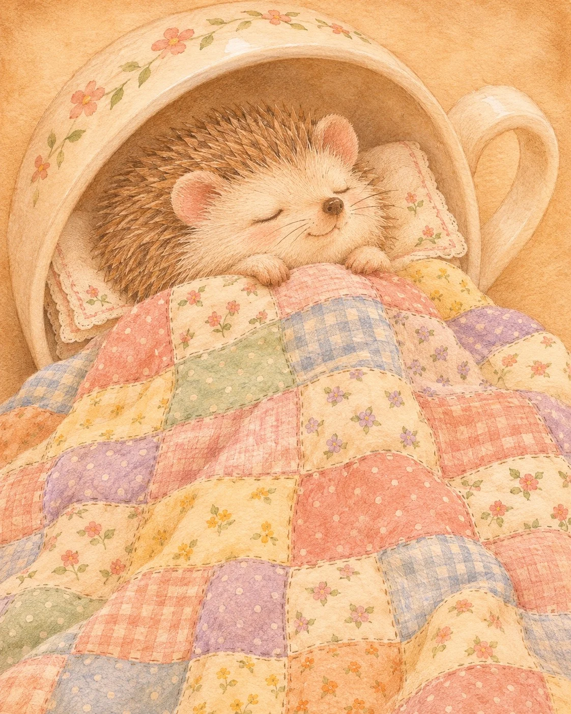

# Watercolor and Colored-Pencil Picture Book: A Hedgehog Asleep in a Teacup

**中文标题：** 水彩彩铅绘本：茶杯里盖着拼布被睡着的小刺猬  
**ID:** `gi25-x-1653` · **Mode:** `generate`  
**Categories:** `general`  
**Tags:** `x-twitter`, `community`, `gpt-image-2.5`, `x-direct`, `zh`



### Watercolor and Colored-Pencil Picture Book: A Hedgehog Asleep in a Teacup

```text
Create an image with the following visual system. Replace the subject as specified.

Visual system (light, color, composition, medium, mood):
【画面风格】一张竖幅约 4:5 的老派儿童绘本插画，透明水彩打底，再用彩色铅笔细细地叠出毛发、木纹和布纹，像一页印在温暖米黄色水彩纸上的原画，纸面的粗颗粒和水彩晕开的边清楚可见，不是数字平涂，不是 3D，也不是照片。机位是近景、略微俯视，正对着一张小小的床（床的样子由主体决定），睡着的小动物占画面上半部分，下半部分几乎被一床大大的拼布被铺满：被子由许多小方块布拼成，每一块是不同的柔和颜色：珊瑚粉、奶油黄、雾蓝、薄荷绿、淡紫、杏橘，每块上面都有用彩铅点出来的小碎花、小格子或小点点花纹，方块之间有细细的缝线，被子边缘自然垂下、有柔软的褶皱。小动物闭着眼、表情安详满足，毛发用一根根细彩铅线画出，耳朵内侧透着淡粉色，胡须是极细的深色线。光是柔和均匀的暖光，像午后的室内，没有强烈投影，只在被子褶皱、枕头凹陷和小动物下巴底下有一点淡淡的暖棕色阴影。整体以暖赭石、蜂蜜黄、米白为底色，拼布的粉、蓝、绿、紫是点缀，饱和度都偏低、像晒旧了的颜色。背景就是空的米黄纸面，四周带一点更深的暖棕晕染。气氛安静、暖和，看一眼就想打哈欠。画面里不要任何文字、签名、印章和水印。

New subject:
【主体】一只圆滚滚的小刺猬蜷在一只放倒的大号奶白色陶瓷茶杯里当床，杯沿就是床头，头枕着一块叠起来的小手帕，背上的刺是一根根浅棕色彩铅线，鼻尖露在外面；一小床拼布被从杯口铺出来，盖住它的身子，垂到画面底部。
```

- **Recommended model:** `gpt-image-2.5-flare`
- **Settings:** _(defaults)_
- **Source:** [community](https://x.com/static_stare/status/2125087899591041227) — @static_stare
- **License note:** Original public X post; quoted with attribution — remix with attribution
- **Notes:** Collected directly from X; original post https://x.com/static_stare/status/2125087899591041227; post text names GPT Image 2.5; discovered via X search, prompt re-verified against the original X post via api.fxtwitter.com; verified=True; visual-system + replaceable-subject template; prompt for image 1 of 4 (the author offers the other three on request); post names GPT Image 2.5 without a Flare/Sunburst variant; preview is image 1
- **Preview:** `previews/gi25-x-1653.webp`
