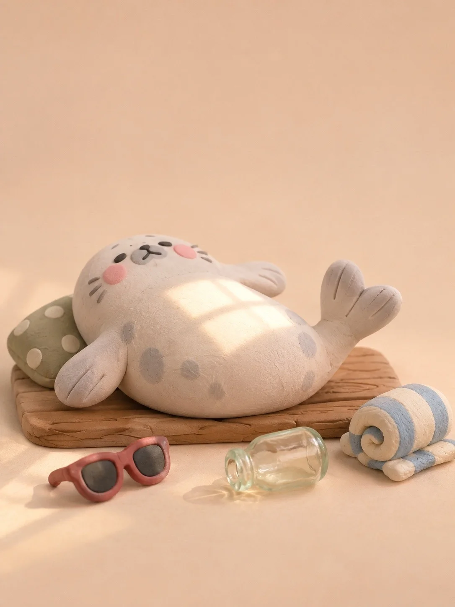

# Hand-Pinched Clay Miniatures: A Seal Sprawl on a Windowsill

**中文标题：** 手捏黏土小摆件：窗台上晒肚皮的小海豹  
**ID:** `gi25-x-1654` · **Mode:** `generate`  
**Categories:** `general`  
**Tags:** `x-twitter`, `community`, `gpt-image-2.5`, `x-direct`, `zh`



### Hand-Pinched Clay Miniatures: A Seal Sprawl on a Windowsill

```text
Create an image with the following visual system. Replace the subject as specified.

Visual system (light, color, composition, medium, mood):
【画面风格】一张竖幅约 3:4 的手捏黏土小场景实拍照片，像桌面上捏好的一组软陶/超轻黏土小摆件，被放在一张暖米杏色的无缝背景纸前拍下来。所有东西都是手捏的：表面是哑光的，带着细小的指纹、压痕和不太规则的边，线条和花纹是用细黏土条贴上去或用工具压出来的，颜色是黏土本身的颜色，没有光泽漆面，也不是 3D 渲染。机位是平视略高、中近景，主体放在画面中下部，上方留出大片干净的米杏色背景。主角是一只简化的圆润小动物（由主体决定），身体是大块光滑的圆弧形，眼睛是两个小黑点，脸颊有两团淡粉色，表情放空、懒洋洋，整个身体瘫软地趴着或摊开，像完全不想动。主角周围散落三四个同样手捏的小道具（由主体决定），随手乱放，让画面像一个真实的、刚被瘫倒过的小角落。光是柔和的大面积窗光，从画面一侧照过来，物体底下有柔和的接触阴影，背景从亮到暗有很轻的渐变，浅景深，背景和最远处的小物件稍微虚掉。整体配色：暖米杏背景，主角是奶白或主体指定的柔和颜色，道具用低饱和的番茄红、芥末黄、雾蓝、草绿和淡粉点缀。气氛松弛、好笑、有点午后犯困。画面里不要任何可读文字、数字、logo、签名、水印和平台标识。

New subject:
【主体】一只灰白色带浅灰斑点的小海豹，仰面摊在一块窄窄的手捏木纹窗台垫子上晒太阳，圆肚皮朝天，两只前鳍摊开，尾鳍翘着；一块亮亮的方形阳光斑落在它的肚子上；旁边散着一副小墨镜、一个喝空的小玻璃瓶（瓶身无字）和一条卷起来的条纹小毛巾。
```

- **Recommended model:** `gpt-image-2.5-flare`
- **Settings:** _(defaults)_
- **Source:** [community](https://x.com/static_stare/status/2125131194853720297) — @static_stare
- **License note:** Original public X post; quoted with attribution — remix with attribution
- **Notes:** Collected directly from X; original post https://x.com/static_stare/status/2125131194853720297; post text names GPT Image 2.5; discovered via X search, prompt re-verified against the original X post via api.fxtwitter.com; verified=True; visual-system + replaceable-subject template; prompt for image 1 of 4 (the author offers the other three on request); post names GPT Image 2.5 without a Flare/Sunburst variant; preview is image 1
- **Preview:** `previews/gi25-x-1654.webp`
