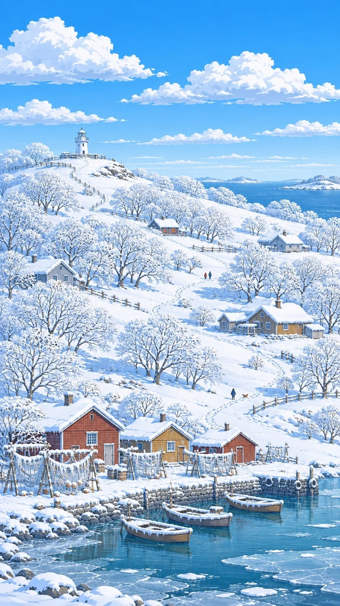

# Flat Winter Illustration: A Snowy Coastal Fishing Village

**中文标题：** 扁平冬景插画：海边雪坡上的渔村  
**ID:** `gi25-x-1656` · **Mode:** `generate`  
**Categories:** `general`  
**Tags:** `x-twitter`, `community`, `gpt-image-2.5`, `x-direct`, `zh`



### Flat Winter Illustration: A Snowy Coastal Fishing Village

```text
Create an image with the following visual system. Replace the subject as specified.

Visual system (light, color, composition, medium, mood):
【画面风格】一张竖幅约 9:16 的扁平精致风景插画，像一张做得很细的冬天海报或明信片，数字绘画，平涂色块加极细的描边和小细节，没有厚涂笔触，也不是照片或 3D。机位是从高处远远地往下看一片起伏的雪坡，俯视角度适中，景深一层一层往后推。画面上方约三分之一是晴朗的天空：上面是饱和干净的天蓝色，往下渐渐变浅成接近白色的淡蓝，天上横着几排蓬松的白色积云，云的底部带一点浅蓝灰阴影，一排比一排小，越往地平线越扁。画面下方三分之二是被厚雪盖住的缓坡，雪面是白色，背光的地方是浅浅的冰蓝和雾蓝，雪坡上用细线画出一道道小路、脚印和一截截木栅栏。坡上长满一棵棵披着白霜的落叶树，树冠是用很多细小的白色和浅蓝枝丫画出来的花边状轮廓，一丛一丛排成有节奏的树团，近处大、远处小。树之间散落着几座小房子和建筑（由主体决定），屋顶都压着厚雪，墙面是浅灰蓝、暖灰或木色，只有一两处是暖色点缀：砖红、赭黄或橘色的屋子和小窗。阳光是冬天上午的清亮阳光，从画面右上方照过来，雪面亮处几乎纯白，阴影是干净的蓝，没有暖黄色调。整体配色：天蓝、白、冰蓝、雾蓝为主，少量砖红、赭黄、木棕做点缀，冷色占绝对多数。人物和动物都很小，只是雪地上几个小点。气氛清冷、晴朗、安静，像大雪停了的第二天。画面里不要任何文字、标志、签名和水印。

New subject:
【主体】雪坡一路往下延伸到画面下方一小片结了薄冰的深青色海湾，海湾边停着三条小木渔船，岸边一排砖红色和赭黄色的小渔屋，屋前晾着挂满雪的渔网架；坡顶有一座矮矮的白色灯塔。
```

- **Recommended model:** `gpt-image-2.5-flare`
- **Settings:** _(defaults)_
- **Source:** [community](https://x.com/static_stare/status/2125199785145909730) — @static_stare
- **License note:** Original public X post; quoted with attribution — remix with attribution
- **Notes:** Collected directly from X; original post https://x.com/static_stare/status/2125199785145909730; post text names GPT Image 2.5; discovered via X search, prompt re-verified against the original X post via api.fxtwitter.com; verified=True; visual-system + replaceable-subject template; prompt for image 1 of 4 (the author offers the other three on request); post names GPT Image 2.5 without a Flare/Sunburst variant; preview is image 1
- **Preview:** `previews/gi25-x-1656.webp`
